# A geological map of Dimorphos in ten steps

You draw the **contacts** and say **which unit** lies where. PRo3D builds the units from that,
draped on the full relief of the body. Reference: [GeologicalMap.md](GeologicalMap.md).

*The pictures are generated by `tests-ui/tests/geological-map-story.spec.ts`, which runs this
story on the Dimorphos test model.*

---

### 1. Start: an empty annotation group

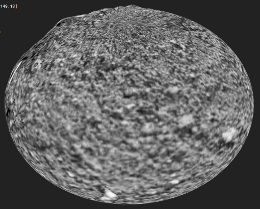

One annotation group, *Dimorphos geology*, made active in the Annotations panel. Everything of the
map - contacts and unit labels - lives in it.

### 2. A new map

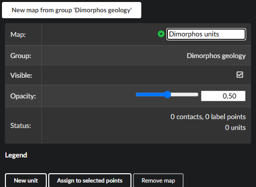

*Geological Maps* panel → **New map from group**. The map is active: what you draw from now on
belongs to it.

### 3. The first contact

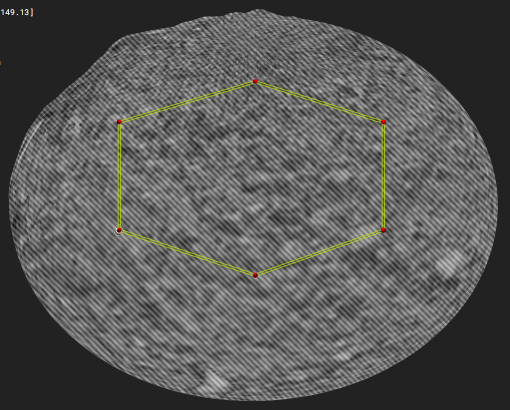

The outline of a smooth lowland, drawn as a polygon. The body now consists of **two units** -
inside and outside the contact. Both are hatched: no unit assigned yet.

### 4. The legend

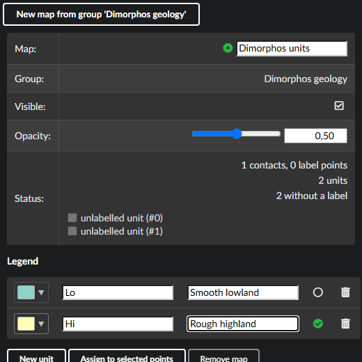

**New unit** twice: code and name for each (`Lo` smooth lowland, `Hi` rough highland), a colour
suggested.

### 5. Assigning units

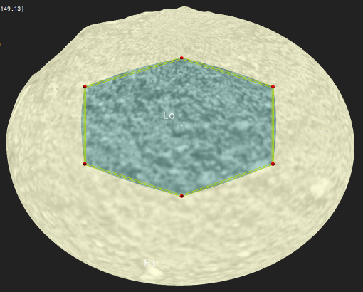

Paint brush tool, pick `Lo` in the legend, click into the lowland; pick `Hi`, click outside.
One click per unit - the colour and the code follow at once.

### 6. Refining: a new contact, snapped

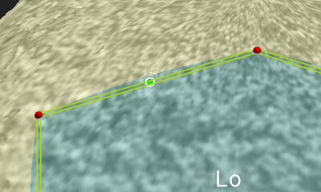

The lowland has an ejecta blanket on its western side. Drawing its contact: near the existing
outline a **green marker** shows where the click will land - exactly on the contact, so the two
meet.

### 7. The preview

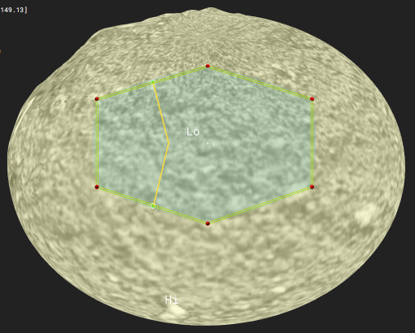

While drawing, the new contact is shown in yellow, the unit it cuts **lights up**, and both ends
are **green**: attached, the cut will close.

### 8. The unit is split

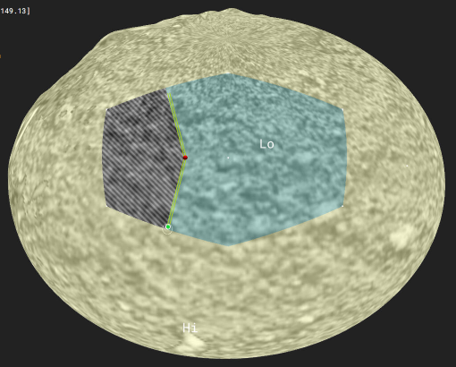

Enter. The lowland is split in two; the new part is hatched - it needs a unit.

### 9. A third unit

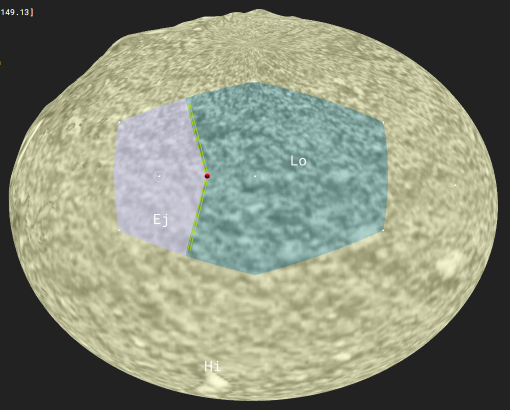

**New unit** `Ej` *Ejecta blanket*, one click into the new part.

### 10. Checking the map

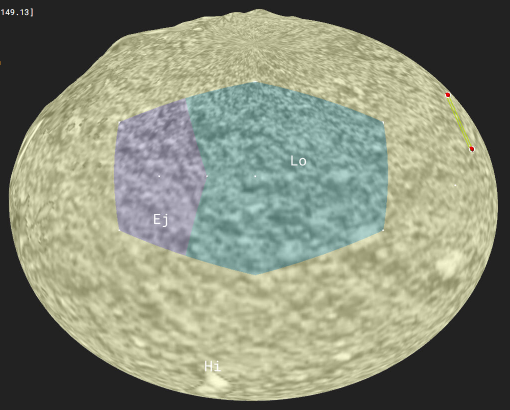

A contact that ends in nothing separates nothing: its ends are marked **red**...

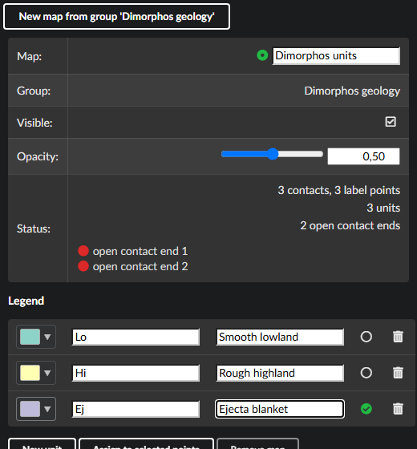

...and listed in the panel. Click an entry to fly there, or press **N** for the next one. Close
the contact, or delete it.

---

**What you never do:** draw or edit a unit's outline. Units are derived from the contacts - every
boundary is drawn once, and changing a contact updates the units on both sides. Save the scene and
everything is back next time; older PRo3D versions still open it, with contacts and label points as
ordinary annotations.
