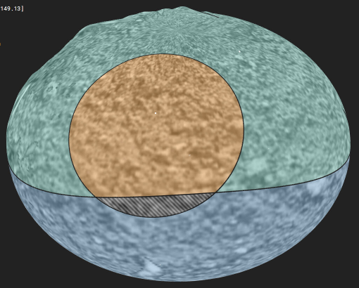
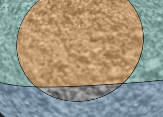
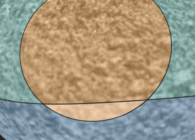
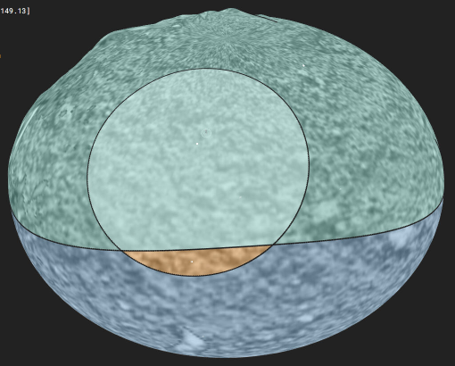
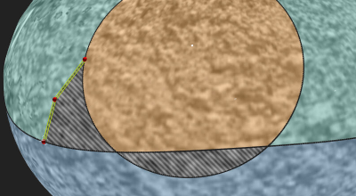
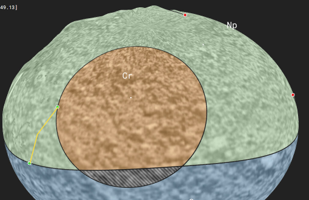
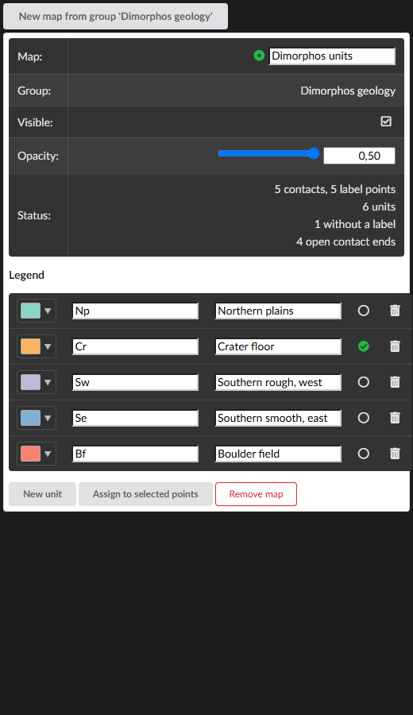
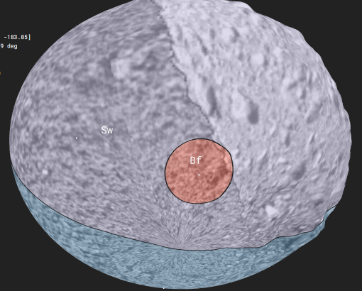

# Geological maps

A geological map in PRo3D is built the way geologists build one in GIS with the *contacts and
points* method (QGIS plugin Mappy): you draw the **contacts** - the lines between units - and
place a **label point** in each unit saying which unit it is. The units themselves, polygons
with holes, are **derived**: PRo3D computes them from the contacts and shows them as coloured
areas on the terrain. Refining a map means drawing another contact; every shared boundary is
drawn once, and changing a contact updates the units on both its sides.

A map can cover a whole small body such as Dimorphos - there is no map projection involved, no
pole or date-line special case.



*The showcase map: contacts (black lines) cut Dimorphos into units, coloured by the legend.
The grey area is a unit without a label point yet.*

Status: first version (#843), **experimental**. What is not there yet is listed [below](#not-yet).

The *Geological Maps* panel opens behind a notice, *This is an experimental feature*, with an
**Open anyway** button. Until then no map is drawn, contacts do not snap and the Assign unit
tool does nothing - a scene with maps costs nothing until you open the panel. **Close** at the
bottom of the panel returns to the notice. This is not saved: every session starts at the
notice; the maps themselves stay in the scene either way.

A walk-through with pictures (a made-up example), from an empty group to a checked map: [GeologicalMap-story.md](GeologicalMap-story.md).

## Concepts

| | what it is | how you make it |
|---|---|---|
| **map** | a set of units over one annotation group | *Geological Maps* panel → *New map from group* |
| **contact** | a line between units | any **polyline**, **polygon**, **line** or **ellipse** annotation in the map's group (polygons and ellipses are closed contacts) |
| **label point** | names the unit it lies in | a **point** annotation in the map's group with a *Geo Unit* |
| **unit** | an area bounded by contacts | derived - never edited directly |
| **legend** | the units' codes, names and colours | the map's legend in the panel |

The map is **immutable**: you cannot edit, split or merge a unit itself. Every change goes
through the contacts and the label points, and the units follow.

## Making a map

1. Create an annotation group for the map (Annotations panel) and make it the active group.
2. Open the **Geological Maps** panel (main menu → *Layout* → *Reopen Panel*), press **Open anyway**, then **New map from group '…'**.
   The map is created over the active group and becomes the **active map**.
3. Draw contacts into the group with the ordinary annotation tools (polyline, **Sky**
   projection). With *Linear* projection a contact's segments are straight lines between the
   clicks, off the terrain, so the drawn line and the units' edges part on uneven ground; the
   first click of such a contact shows a warning in the 3D view. A point placed within **10 pixels of an existing contact snaps
   exactly onto it**, so a contact drawn to end on another one meets it. Alternatively let a
   contact **overshoot** the one it ends on - the overhanging piece is trimmed automatically.
4. Add units to the legend with **New unit** and give each a code (`Cr`), a name (*Crater
   floor*) and a colour.
5. Assign units with the **Assign unit** tool (paint brush in the tool strip), below.

Making a map active also makes its group the active annotation group, so whatever you draw next
lands in the map.

## Assigning units

Make a legend entry **active** (the circle in its row; **New unit** activates the new one), select the **Assign unit** tool, then,
with the tool's click gesture (Ctrl+click, or a plain click in
[Direct Tool Mode](DirectToolMode.md)):

| gesture | does |
|---|---|
| **click** a unit | it takes the active unit |
| **drag** across units | every unit the cursor passes takes the active unit |
| **Alt+click** a unit | eyedropper: its unit becomes the active legend entry (a click with no legend entry active does the same) |
| hover | the unit under the cursor is highlighted |

Under the hood a unit's unit is its label point: clicking a unit without one places a label point
where you clicked; clicking one that has label points changes their unit. Every assignment is one
undo step.

 

*The hatched unit has no label yet; one click with `Cr` active gives it the crater unit.*



*Alt+click on the plains picked their unit, a drag from the plains into the crater gave the
crater the same unit (highlighted: under the cursor).*

Assigning is fast whatever the map's size: the units' outlines do not change, only one colour
table, and what is under the cursor is read from the rendered image - no ray is cast against
the terrain, so the tool does not wait for a surface's KdTree to load.

Other ways to label: select point annotations and press **Assign to selected points**; draw a
**point** into the active map's group while a legend entry is active; or type the code into
*Geo Unit* in the annotation properties.

## Snapping

While you draw a line (polyline, polygon, line) into the active map's group, every point you
place within 10 pixels of one of the map's contacts lands exactly on that contact. Before you
click, a **green marker** under the cursor shows where the click will land (with the tool armed:
Ctrl held, or always in Direct Tool Mode). Only contacts near the picked terrain point count, so a
contact on the far side of the body never takes the click. Ellipses do not snap: they are drawn
from their axes, not from points on their outline. Snapping is what makes units close: two contacts that merely come close leave a
gap, and the map shows two open ends there.



*A new contact from the crater rim to the equatorial contact, both ends placed a few pixels off
the lines: they snapped, and the plains split into a new, still unlabelled unit.*

### Split preview

While you draw a contact into the active map, the preview shows what it will do before you
finish it:

- the cut so far, in yellow - straight pieces between the clicked points and on to the cursor,
  drawn on top of everything (the finished contact is draped on the terrain and may run slightly
  differently);
- the unit(s) it runs through, lit up - the unit it is about to split;
- its ends: **green** where an end sits on a contact (the cut closes there), **orange** where it
  is still open (finishing it like that leaves an open end). An open end of another contact that
  the stroke joins stops being shown red.




## Problems

The panel lists what needs attention - unlabelled units, units with conflicting labels, open
contact ends. **Click an entry** to fly there; press **N** (with the Draw annotation or Assign
unit tool) to fly to the next one. Open contact ends are marked in the 3D view with red dots.

## The panel



Per map:

- **Map** - the active map (green dot) and its name.
- **Group** - the annotation group it is built from.
- **Visible**, **Opacity** - the units are drawn semi-transparent (default 50 %), so the
  terrain stays readable underneath.
- **Status** - what the map currently consists of, and what needs attention:
  - *without a label* - units with no label point: drawn grey and hatched;
  - *conflicting labels* - a unit holding label points of different units, usually a missing
    contact between them: drawn magenta;
  - *open contact ends* - ends of contacts that reach no other contact. Their dangling pieces
    do not bound anything; an overshoot you drew on purpose shows up here too;
  - *topology check failed* - the contacts could not be turned into units consistently.
- **Legend** - colour, code, name, the active unit, remove. Renaming a code renames it on the
  map's label points too, so units keep their colour; a code another unit already has is refused.
  Legend edits are not undo steps.
- **Remove map** removes the map only; its contacts and label points stay as annotations.

A scene can have several maps (two interpretations of the same area, units vs. morphology);
one is active at a time.

## How the units are drawn

Units are drawn like [filled annotations](AnnotationFill.md): every terrain pixel inside a unit
is tinted, at every level of detail and on its full relief - a boulder or a crater wall inside
a unit is coloured completely. The boundary between two units is exactly where their contact
runs, seen from the body's centre. The [fill reach](AnnotationFill.md#fill-reach) bounds how far
above and below the contacts the colouring reaches.



*The southern side: a meridian contact splits the south into two units; a small closed contact
is a boulder field inside one of them (a unit with a hole).*

Each unit's **code** is written inside it, at a fixed size on screen. A large unit has several
places for it, spread over its area, and shows the code at the one facing the camera most; codes
of units facing away are hidden. Units without a label have no code (they are hatched).

Unlike outlines, the units are only drawn in views that render their surfaces offscreen (main
and instrument view); [Snapshots](../ai/AUTOMATION.md) and the [map projection view](MapProjectionView.md) do not show them yet.

## Where it is stored

Maps are saved with the annotations, in the scene's `.pro3d.ann` file, under new keys
(`geologicalMaps`, and `geoUnit` on label points). The derived units are not stored - they are
recomputed on load and on every change. Older PRo3D versions open such scenes and ignore the
maps; contacts and label points stay ordinary annotations there.

## Limits

- **Bodies**: units are computed and drawn as seen from the body's centre, which is exact on
  a sphere and correct on any body where each ray from the centre meets the surface once
  (Dimorphos, Didymos, Mars). Bodies with overhanging shapes (67P) are not supported.
- Map scenes need the scene body set (annotations in body-fixed coordinates).

## Not yet

These are planned (see `docs/dev/GeologicalMap-plan.md`):

- export to GeoPackage.

## How it works

Algorithms, acceleration structures and precision: [dev/GeologicalMap-architecture.md](dev/GeologicalMap-architecture.md).

## Showcase

The scene in the screenshots is generated from the Dimorphos test OPC:

```
set PRO3D_TEST_DATA=<PRo3D.Resources.TestData checkout>
dotnet run --project src/Tests -c Release -- --make-geomap-showcase
```

writes `cases/geologicalMap/dimorphos-geological-map.pro3d` (+ `.pro3d.ann`) into the test
data; `tests-ui/tests/geological-map.spec.ts` opens it and drives the panel.
