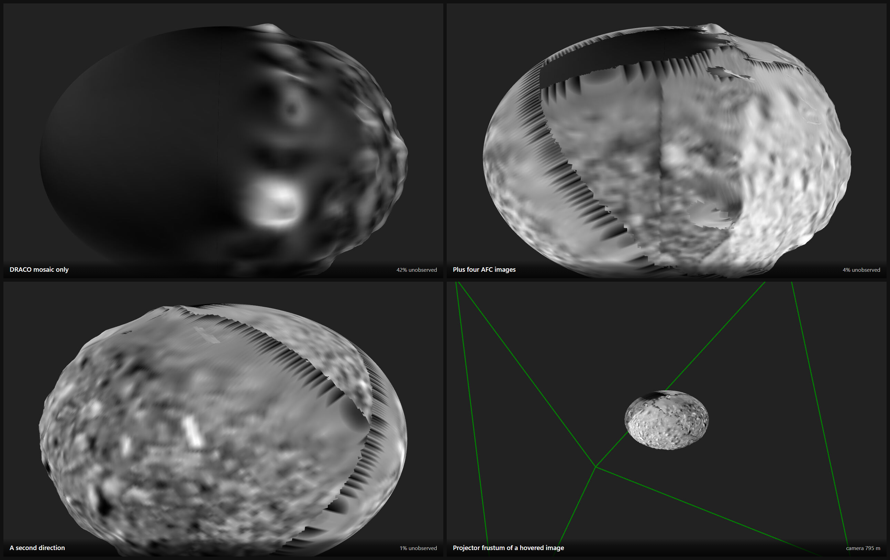
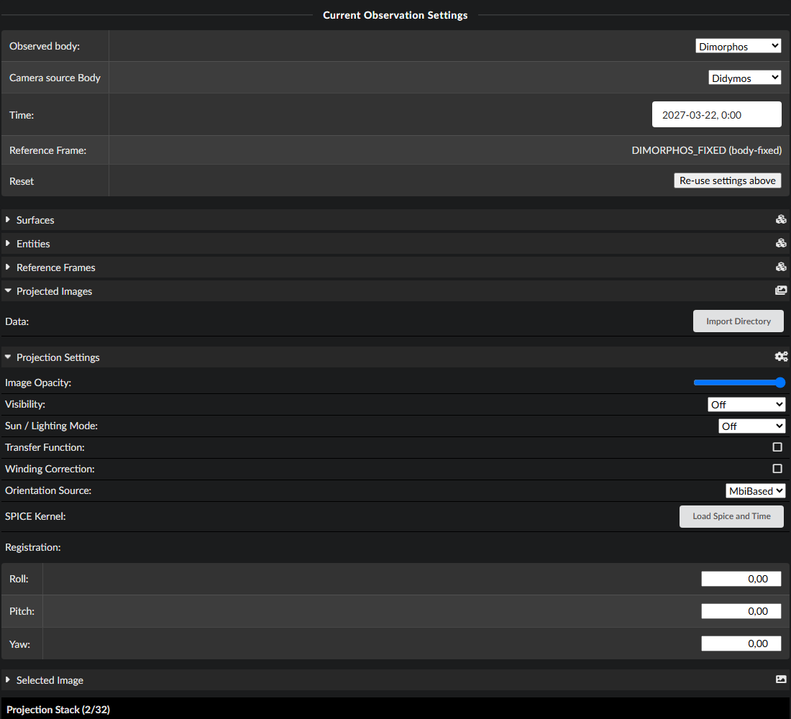
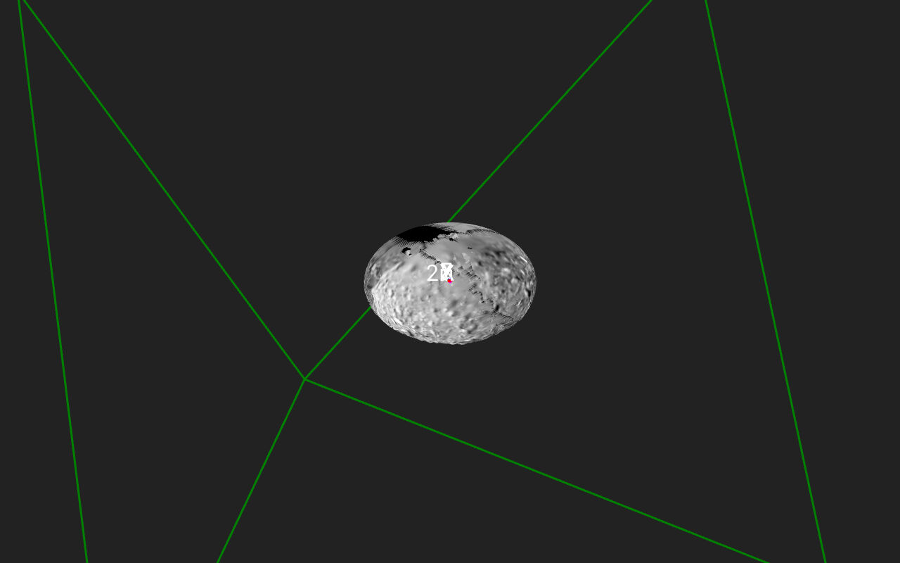
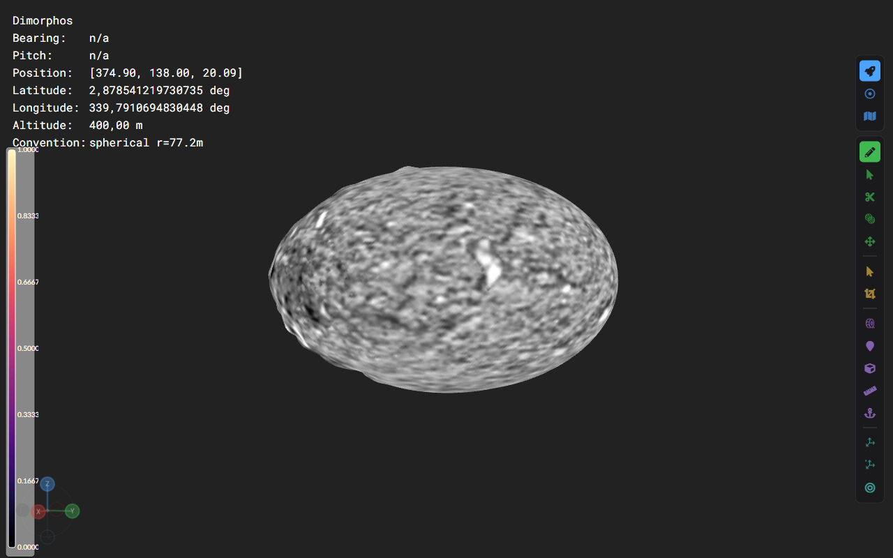
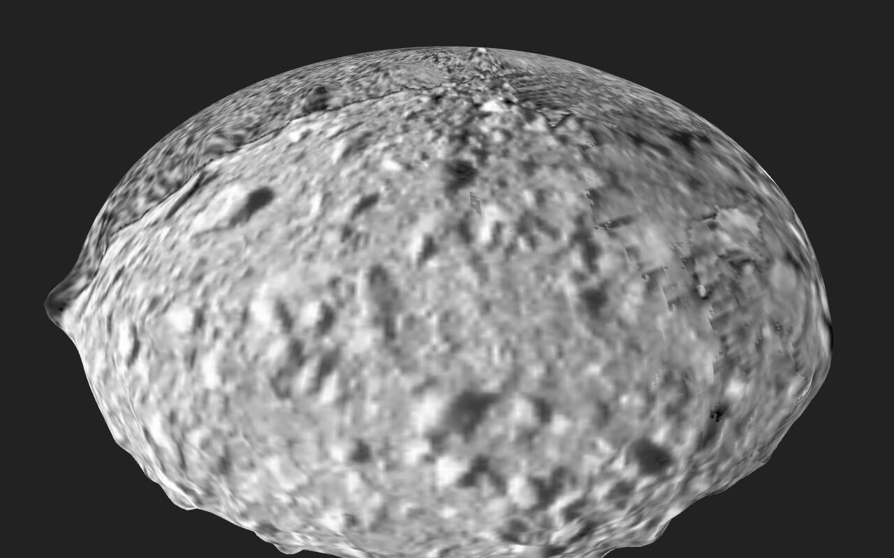
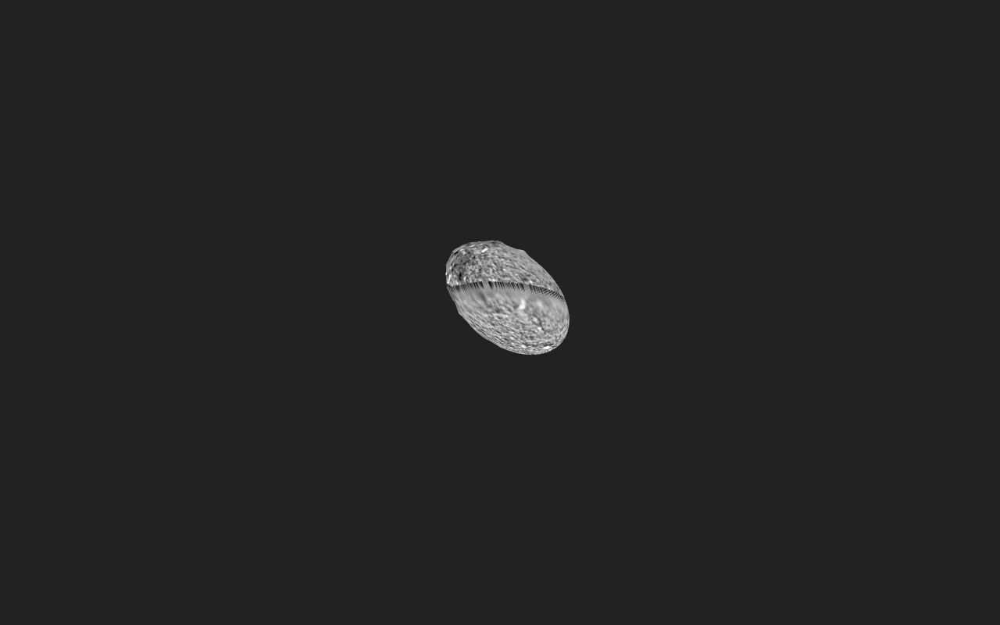
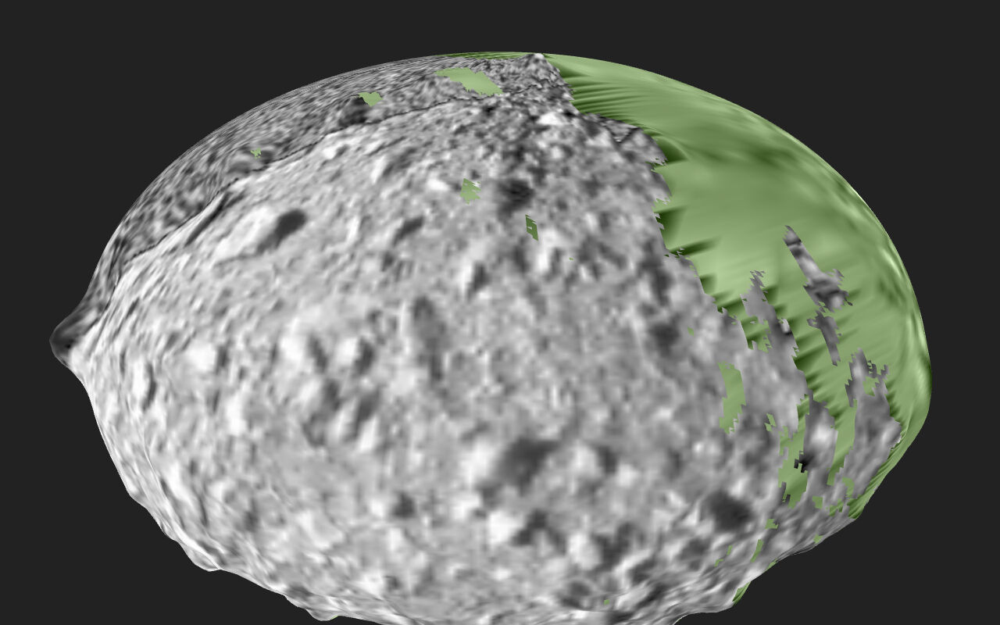

# Multi-Image Projection



Project an **ordered stack of up to 32 same-instrument images** onto a surface
at once — e.g. a flyby sequence over an asteroid. Lives in its own
**Projected Images** panel (a tab next to the GIS View in the *M2020*, *GIS*,
*PRo3D Core* and full layouts; bring it back with *Layout → Reopen Panel* if a saved
layout of yours does not show it — see [WindowLayouts.md](WindowLayouts.md)).

Order and opacity are both set in the GUI:

- **Order** — where images overlap, the one **higher in the stack wins**
  (painter's order, opaque). Reorder with ↑ / ↓ in the stack panel.
- **Opacity** — *Projection Settings → Image Opacity* blends the stack's result
  with the surface texture underneath.

Panels 1 and 2 above are the same camera on the same body. Dimorphos carries its
DRACO mosaic, which does not cover it entirely: from this direction **72% of the
visible body is unobserved** and renders black. Four AFC frames bring that to
**7%**.

# Workflow

## 1. Set up the scene

Pick the body under **Reference System** in the top bar. That sets the
[scene body](SceneBody.md), and a surface with no GIS assignment of its own
belongs to it — so for a single-body scene there is nothing else to set. A SPICE
kernel covering the observation epochs must be loaded: **Load SPICE kernel** next to
**Reference System**, or the main menu.

For surfaces of *other* bodies, assign entity and frame explicitly in
GIS tab → *Surfaces*. Two things to watch:

- The entity must be the body the OPC actually is — assigning `Didymos` to a
  Dimorphos OPC draws it a kilometre off.
- Assign **both** or **neither**. A surface with a body but no frame, or a frame
  but no body, stays unplaced.

The walkthrough below uses the Dimorphos OPC that ships with
[PRo3D.Resources.TestData](https://github.com/pro3d-space/PRo3D.Resources.TestData):

```
HERA/Dimorphos_opc/Dimorphos_DRACO1_DRACO2_Earth/Dimorphos/
```

## 2. Import a folder of images

*Projected Images → Image Library → Import Directory* (at the top of the
section); the imported folder is shown next to the button (*not set* before the
first import). Every image of the folder (`.tif/.png/.jpg/.exr`, each with its
`.mbi.json` sidecar) lands in the **library**, the section's *Images* list. Its
columns are the same as the Image Search's (docs/StacImageSearch.md):

| column | meaning |
|---|---|
| Preview | a thumbnail of the file (the first band, stretched; rendered on first view and cached in `%TEMP%\PRo3D\thumbnails`) |
| Add | add to / remove from the projection stack |
| Go to | the arrow flies to the image's camera (and sets the time); the clock only sets the GIS time to the image's observation time, the camera stays |
| **Instr.** | instrument, from the metadata |
| **Distance** | distance to the target's centre (red *no TRG_POS* when the metadata has none) |
| **Date (UTC)** | observation time, to the minute (the full time in the tooltip) |
| **Res.** | resolution: ground size of one pixel at the target's centre |

Above each row is the file name; click it to select the image. Instr.,
Distance, Date and Res. sort the list; a second click sorts the other way
round. Sorting never changes what is projected.

The chosen folder is **saved with the scene** (key `projectedImagesDirectory`
in the GIS section) and re-imported when the scene is opened. If the folder no
longer exists — e.g. a scene from another machine — a notice says the projected
images could not be loaded; the scene keeps the path until you import a folder
again.

The **projection stack is saved too**, as the images' file names in draw order
(key `projectedImagesStack`), and rebuilt after the re-import. Stack images no
longer in the folder are left out and listed in a notice. That includes
images added from the [Image Search](StacImageSearch.md): they live in the
download cache, not in the imported folder, so they are not restored. Both keys are
additive: the scene version is unchanged and older releases ignore them.
Per-image settings (colour map, channel, ranges) are not saved yet.

The four AFC-1 frames used throughout this page are in the same test-data
repository:

```
HERA/Dimorphos_opc/AFC_2027-03-21/
```



An italic hint at the top of the panel reminds you that the SPICE kernel matching
the images must be set. Below the import button the panel folds into four
sections:

- **Projection Settings** (closed by default) — see the table below.
- **Selected Image** — the image selected in the library, in two sub-sections
  that each fold away with a click on their header: **Preview Image** (its 2D
  preview) and **Properties**, in three sections:
  - **Data** — *what* is shown: the *Channel* and the *Range*, the min/max of its
    values that span the colour map (and that the legend labels), as one two-handle
    slider with an input box at each end. The header's undo icon resets the range to
    the image's statistics: those of its `<image>.tif.json` sidecar, or, for a TIFF
    delivered without one, the min/max of its finite pixel values, read at import.
  - **Tone** — *how* it looks, purely visual: *Brightness* (−1…1, default 0) shifts
    the values, *Contrast* (0…3, default 1) scales them around mid grey; reset by the
    header's undo icon. Acts on the values within the *Data* range, before the colour
    map, in the preview and on the surface — there only with *Apply Image Adjustments* on
    (off, the surface shows the image untouched, and Properties says so in an amber
    hint with an *Apply image adjustments* button).
  - **False Colour** — the header's checkbox switches the colour map on (off: grey
    values); *Colour Map* and *Legend* (in the main view) are dimmed while it is off,
    and the legend is not shown in the main view then, whatever its checkbox says.
    The switch applies per image, in the preview and on the surface alike (with
    *Apply Image Adjustments* on): an image with it off is projected in grey values.
    So is the **colour map**: every layer on the surface uses its own image's map.

  Every image keeps its own settings; they are not saved with the scene. *No image is
  currently selected* when there is none.
- **Filters** — shared by the Image Library and the Image Search (see below).
- **Image Library** — *Import Directory*, then **Images**, the image list
  itself (*showing x of y* in its header; folds away with a click on it).
- **Image Search (STAC)** — the catalog search, its results in the same kind
  of list ([StacImageSearch.md](StacImageSearch.md)).
- **Projected Images** — the projection stack (see 4.).

*Projection Settings* holds:

| setting | what it does |
|---|---|
| **Image Opacity** | blends the projected stack over the surface texture (formerly labelled *Visualization*) |
| **Visibility** | *RelativeCount* shows the coverage view (see 6.) |

Lighting is set in *GIS View* → *Settings* → **Sun / Lighting Mode**
([GisView.md](GisView.md#sun-illumination-and-cast-shadows)). In every mode a
projected image shows only its own pixels (in proportion to *Image Opacity*): neither the
headlight nor the sun's shading and cast shadows are applied to it. The image is a
photograph that already shows the sun's light and shadows; shading it by the terrain
again would count them twice. The surface around the image is lit as usual.
| **Apply Image Adjustments** | on (default): samples go through each image's *Range*, *Brightness/Contrast* and *False Colour* (Selected Image › Properties), which instrument data needs to be readable. Off: the image's own pixels, untouched — for RGB images, and for checking a projection against its source. While it is off, the selected image's Properties show a hint with a button to turn it on. (Formerly *Transfer Function*.) |
| **Winding Correction** | off (default). Turn it on only when an image survives **only near the limb** of the body: that is an OPC whose triangles are wound inward, so the projector-facing test rejects exactly the terrain facing the projector. On: PRo3D estimates each OPC hierarchy's winding from its coarsest patch (loaded once, the first time something is projected) and corrects the inward ones. The estimate assumes a roughly convex body seen from orbit; it is not reliable for near-vertical terrain such as rover outcrops. Saved with the scene. |
| **Orientation Source** | where the projector's position and attitude come from — *MBI attitude, SPICE range* (`MbiAttitudeSpiceRange`, default), *MBI* (`MbiBased`), *SPICE (instrument frame)* (`Spice`) or *SPICE, aimed at target* (`SpiceAimed`); see [If an image does not land on the terrain](#if-an-image-does-not-land-on-the-terrain) |
| **Registration** | roll / pitch / yaw in degrees, turning the projector about its own position (a pointing correction); applies to every image of the stack |

The **Instrument Settings** section below it holds each instrument's field of view, prefilled from
the SPICE instrument kernels and editable per scene: see
[InstrumentFieldOfView.md](InstrumentFieldOfView.md).

### Filters

The **Filters** section (its title shows *(n active)*; *reset all* resets them)
narrows down both the **Image Library** and the
[Image Search (STAC)](StacImageSearch.md) results, by the same rules: a catalog
image is checked on its downloaded metadata exactly as it would be in the library.
The filters only hide rows: the projection stack and the selected image are left
alone. The library's *Images* header says how many rows are shown
(*showing x of y*).

The ranges are **fixed**, independent of the loaded images, so they also cover
catalog images that are not loaded yet. *Distance* and *Resolution* span many
orders of magnitude (cruise to close proximity): their sliders run on a
**logarithmic** scale; the bound fields show and take real values.

| filter | kind | effect |
|---|---|---|
| **Phase Angle [°]** | range, 0–180° | the angle at the target between the sun and the camera, from the sidecar's sun (`SUN_POS*`) and target (`TRG_POS*`) vectors: low = lit from behind the camera, flat with few shadows; around 90° = side lighting, long shadows; high = backlit. One value per image, at the target's centre — unlike sun elevation/azimuth, which change across the surface of a small body. Images without it (no sidecar) are shown while the filter is off and hidden while it is set |
| **Instrument** | the HERA instruments (AFC1, AFC2, HSH, TIRI, ASPECT) and any further one in the library, as toggle buttons | shows only the selected instruments; images without one are listed as *(unknown)* |
| **Resolution [m/px]** | range, 0.001–100 000 m/px, logarithmic | ground resolution at the target: distance × the angle one pixel spans (the instrument's horizontal field of view ÷ the image width). Measured at the target's centre, so on the surface facing the camera pixels are slightly finer. Images without one (no sidecars, or an instrument with no known field of view) are shown while the filter is off and hidden while it is set |
| **Distance [km]** | range, 0.1–10⁹ km, logarithmic | distance to the target |
| **Date [UTC]** | range, 2026-11-01 to the end of today (today as of PRo3D's start). Off at start, like the others: the library then shows images of any time, including ones outside the range. The Image Search always sends the selected dates to the catalog, also while the filter is off | observation time from the image's sidecar: the slider, and below it a date/time field per bound (UTC, to the second). Images without a time (no sidecar) are shown while the filter is off and hidden while it is set |

A range is set by typing its bounds or by dragging the two handles of its
slider. A filter is **off** — plain label, not counted — while its whole range is
selected, or, for *Instrument*, while no instrument is selected. All filters start
off. An active filter's
label turns amber with a filter icon, and ↶ next to it resets it. Filters are not
saved with the scene; importing a folder keeps them.

To find images of a spot in a STAC catalog instead of a local folder, see
[Image Search (STAC)](StacImageSearch.md); the same filters apply there.

## 3. Find images by hovering

**Hovering a library row previews that image in 3D as the top layer of the
stack.** This is the workflow for finding good images: sweep the library and
watch each one land. Nothing is added — move the pointer away and the preview is
gone. Hovering a row whose image is already *in* the stack does not duplicate its
layer; it only draws the two markers below.

Alongside the preview, two things are drawn for the hovered image alone:

- its **projector frustum**, a green wireframe from the instrument to the body,
- a **green outline** wherever the edge of its footprint crosses the terrain.



The frustum is drawn at the instrument's real standoff, so pull the camera back
to see it whole — above, the camera is 795 m out and the projector 8.4 km.

The outline appears only where a footprint *edge* falls on the terrain. The
AFC-1 frames here were taken from 6.7–8.4 km; at 5.5° that is a footprint
644–807 m across, which covers the 154 m body entirely, so none is drawn.

**Selecting** a row (a click on its name; a second click deselects it, one image
at a time) is a different thing: it shows that image's 2D
preview and display settings under *Selected Image* and makes its min/max and colour map drive the whole stack's legend. On
its own it projects nothing.

## 4. Build the stack

The **+** in a row adds the image to the top of the **projection stack**
(cap: 32). The stack panel in the *Projected Images* section lists the projected images top-first with a count
indicator. **Drag a row onto another** to reorder: the dragged image takes the
target's position and the images in between shift by one (the drop target is
outlined in blue; the ☰ handle marks the rows as draggable). ↑ / ↓ move one
step, ✕ removes.

Feedback while reordering:

- **Hovering a stack row** keeps that image at full strength and fades the
  other stack layers to about a third, so you see which image you are about
  to move (with its green footprint outline and frustum). Hovering a
  **library** image fades the stack only slightly (to about ¾) while that
  image is previewed on top.
- **While dragging**, the 3D view already shows the order the drop would give:
  every row you pass over is previewed. The list itself keeps its order until
  you drop; the dragged row is shown half-transparent.
- **Drop** takes the order over; releasing elsewhere or pressing Esc goes back
  to the order before the drag.



## 4a. Does it actually land? Slide the opacity

The AFC images in the test data were simulated from this same shape model with
`pro3d-tool simulate-image`, so a correct projection lands exactly on the texture
underneath. Drag *Image Opacity* from 0 to 1 and watch:



- **Nothing shifts or doubles** — image and texture coincide.
- **A ghost or doubled crater edge** — the projection is landing in the wrong
  place; see [If an image does not land on the terrain](#if-an-image-does-not-land-on-the-terrain).

Measured on the shipped test data by `tests-ui/src/probe-docs-shots.ts`: at opacity
0 the frame is **pixel-identical** to the bare surface, and at opacity 1 **7.9%**
of it differs. That residue is the image's own noise and shading. A projection
landing in the wrong place moves crater edges, which shows up as a much larger
difference concentrated along them.

Set two things first, or the comparison is meaningless: **Apply Image Adjustments off**
(otherwise you are comparing a false-coloured image against a greyscale texture)
and **Orientation Source → `MbiBased`** (the sidecar pointing the frame was
generated with).

## 5. Fly to an image

The location-arrow button (library and stack rows) puts the camera onto that
image's **projector axis**: forward along the instrument boresight, standing
off just far enough to frame the instrument's footprint — the rendered view
then corresponds to what the instrument saw:



The body sits small in that frame on purpose: what is framed is the **footprint**,
and for these AFC-1 images it is 650-810 m across against a 154 m body.

- **It also sets the scene's observation time** to the image's epoch, so the
  sun, the body's placement and everything else SPICE-driven match the moment
  the image was taken. That changes the scene time you save with the scene.
- **The camera jumps; it does not animate** (an animated version is planned).

Setting *Focal (mm)* on the Config page to the instrument's focal length makes
the fly-to land exactly where the instrument was. If fly-to does nothing, the
log names the missing precondition (observed body, SPICE-bound surface, or the
image itself).

## 6. Where do my images overlap?

*Projection Settings → Visibility → RelativeCount* tints the surface by the
**fraction** of the stack that covers each fragment — not by an absolute count,
so with a two-image stack a single covering layer already reads as half. The tint
is blended at 20% over the surface colour:



# Data expectations

- All simultaneously projected images come from the **same instrument** (they
  share dimensions and intrinsics; the FOV comes from
  `PRo3D.Base.InstrumentProjection`, currently AFC-1/AFC-2/HSH/ASPECT).
- Sidecars are matched by the band file names they declare, case-insensitively
  and with `.tif`/`.tiff` and `.jpg`/`.jpeg` treated as the same file, then by
  the name without its extension. When no sidecar declares the image, the
  sidecar is found by file name: `<image>.mbi.json`, then the image name with
  up to two trailing `_SEGMENT`s removed (`<obs>_AFC1.tiff` →
  `<obs>.mbi.json`). A sidecar found that way is not used if a band file it
  declares exists on disk, because then it belongs to that file. The log names
  every image associated by file name. The observation time comes from
  `DATE-OBS`, falling back to the file-name timestamp (`_yyyyMMdd_HHmmss_`)
  and then `DATE`. Positions declared as km that are actually metres are
  auto-corrected (detected via the sun distance). The projection target body
  comes from the sidecar's `TARGET`. See
  [COP-sidecar-issues.md](COP-sidecar-issues.md) for the data defects these
  fallbacks absorb.
- Per-image display settings (channel, min/max, brightness/contrast, false colour
  and colour map) are edited under *Selected Image* and apply to that image's layer
  only. The legend shows the selected image's map and range.

## If an image does not land on the terrain

First check **Orientation Source** in *Projection Settings*. It decides where
the projector's position and attitude come from:

| mode | position | attitude (incl. roll) | target in the image |
|---|---|---|---|
| `MbiAttitudeSpiceRange` (default; *MBI attitude, SPICE range*) | on the boresight, at the SPICE range to `TARGET` | the sidecar's `SC_QUAT` | always dead centre |
| `MbiBased` (*MBI*) | the sidecar's `TRG_POS`, measured from its `TARGET` | the sidecar's `SC_QUAT` | wherever the sidecar's pointing puts it |
| `Spice` (*SPICE (instrument frame)*) | SPICE (spacecraft SPK) | SPICE: the instrument's own frame, spacecraft CK × frames kernel; not aimed | wherever SPICE's pointing puts it |
| `SpiceAimed` (*SPICE, aimed at target*) | SPICE (spacecraft SPK) | SPICE (spacecraft CK, no frames kernel), then turned onto the target | always dead centre |

The dropdown shows the labels in italics; the enum names are what logs use, and the
`pro3d-tool --method` options are `mbi-spice-range`, `mbi`, `spice` and `spice-aimed`.

- **`MbiBased`** is exact when the sidecar is, and faithfully wrong when it is
  not. It needs `TRG_POS`: an image whose `TRG_POS` is zero shows **no TRG_POS**
  in the library's distance column, and `MbiBased` does not project it. An all-zero
  `SC_QUAT` (no attitude) rules out both `MbiBased` and `MbiAttitudeSpiceRange`;
  only `Spice` / `SpiceAimed` can place such an image. Both cases are logged with the reason.
- **`Spice`** needs the spacecraft's SPK and CK and the frames kernel (FK) at the
  image's epoch: it asks SPICE for the instrument's own frame, so the FK's mounting,
  misalignment and twist are applied, and it is **not aimed** — the image lands
  where SPICE's predicted pointing puts it, and a pointing or ephemeris error stays
  visible. See [The frames kernel](#the-frames-kernel-instrument-mounting).
- **`SpiceAimed`** (what `Spice` was before) needs the SPK and CK. It uses the
  spacecraft attitude without the frames kernel, and its turn onto the target
  absorbs the ephemeris error between where SPICE puts the body and where the
  camera actually pointed, so the image always lands on the body — and every
  pointing error is hidden; without a CK the roll is arbitrary (logged) and the
  Registration roll fixes it.
- **`MbiAttitudeSpiceRange`** is for sidecars without a usable `TRG_POS`, and
  for kernels whose spacecraft-to-target direction is worse than the measured
  attitude — typically before arrival, when the target's ephemeris is known to a
  few kilometres while the star-tracker attitude is good to arcseconds. It keeps
  the image's own roll; only the range comes from SPICE.

The "dead centre" modes assume the target's centre is on the boresight. When it
is not (the body sits off-centre in the frame), correct it with **Registration
→ Pitch / Yaw**: they turn the projector about its own position, moving the
image across the body like a pointing offset — 1° moves the image by 1/2.75 of
the AFC's half-field. **Roll** turns the image about the boresight. The
correction applies to every mode and to the whole stack.

So "lands on the body but does not match it" points at a dead-centre mode (use
Registration, or `MbiBased` when `TRG_POS` is good), and "does not land at all"
points at `MbiBased` plus a sidecar problem.

The target is the sidecar's `TARGET`. When SPICE cannot place it (a body name
the loaded kernels do not define) the surface's body
stands in, and the log says so.

An image that lands **mirrored** (lit limb where the terminator should be, a moon on the
wrong side) is stored bottom-up: tick **flip** for its instrument under
*Instrument Settings* ([InstrumentFieldOfView.md](InstrumentFieldOfView.md#flipped-rows)).
Registration cannot undo a mirror.

The pointing comes from two sidecar fields, and they have one convention:
`SC_QUAT0..3` is the quaternion taking vectors from the **spacecraft frame to
J2000**, and `TRG_POSX/Y/Z` is **target minus spacecraft** — a vector from the
camera to the body named in `TARGET`, in km. A sidecar written the other way
round (a conjugated quaternion, a negated vector, or one measured from the
system primary instead of the target) parses perfectly, projects without
complaint, and puts the image nowhere near the body. Nothing in the file says
which reading was meant, so PRo3D cannot fall back.

A generator can self-check: transform `TRG_POS` into the spacecraft frame and
it must come out close to `(0, 0, +1)` — the target is what the camera looks
at, and the boresight is +Z.

To tell a metadata problem from a rendering one, render the body yourself and
project that back:

```
pro3d-tool simulate-image --opc <the same OPC> --time <epoch> --body <body>
    --frame <body-fixed frame> --out sim.png --write-mbi
```

`--write-mbi` writes a sidecar for the camera the render actually used, so
importing `sim.png` and projecting it must lay the image exactly over the
terrain it came from. If it does, the projection chain is fine and the problem
is in the other images' metadata — see
[COP-sidecar-issues.md](COP-sidecar-issues.md), which documents a delivery that
got all three of the above wrong at once.

### The frames kernel (instrument mounting)

SPICE applies a frames kernel's instrument mounting (the instrument's fixed
orientation relative to the spacecraft: nominal axis swap plus misalignment and
twist) **only when asked for the instrument's own frame**. Every orientation
source except `Spice` builds the camera from a *spacecraft* attitude — the spacecraft's
CK frame, or the sidecar's `SC_QUAT` — plus PRo3D's fixed 90° axis swap
for the instrument (`InstrumentProjection.specialTrafos`), and so never sees the
FK. `Spice` asks for `pxform(<instrument>, J2000)`, i.e. CK × FK.

The image axes keep PRo3D's established orientation: `Spice` computes the old
spacecraft-based camera, takes the signed axis permutation nearest to the
rotation between it and the instrument frame, and uses the instrument frame
relabelled by that permutation. Frames kernels that label the instrument axes
differently (e.g. a version that twists them by 90°) therefore render alike. If the instrument frame is more than 5° from every relabelling of the
spacecraft-based camera (or the relabelling would mirror), the projector fails
with an error naming the instrument — usually the wrong frame name or a missing
frames kernel. The log line of a successful resolve gives the angle between the
two cameras: the FK misalignment.

Whether a sidecar's `SC_QUAT` is the spacecraft or the instrument attitude is a
property of the delivery; comparing `MbiBased` with `Spice` on the same frame
tells. To check a frames kernel against real frames, render with
`pro3d-tool simulate-image --mbi <frame> --method spice` (CK × FK, not aimed) or
`--method mbi-spice-position` (the sidecar's attitude at SPICE's position, not
aimed) and compare with the frame ([Pro3DTool-SimulateImage.md](Pro3DTool-SimulateImage.md)).

Worked through with pictures, the old `Spice` (now `SpiceAimed`) and `MbiBased`
side by side (from before it took its roll from the CK):
[ProjectionValidation.md](ProjectionValidation.md).

## Known limitation: surface transformations do not reach the projection

The projector is computed in the OPC's own coordinates, taken as the body-fixed
frame of the surface's SPICE reference frame. Nothing a surface is transformed
by afterwards is part of that. What this means depends on the transformation
([#741](https://github.com/pro3d-space/PRo3D/issues/741)):

- **Pre-transformation, Flip Z, SketchFab**: these change what the OPC's
  coordinates *mean*, so a projection would land in the wrong place. PRo3D
  therefore **projects nothing onto such a surface**, and *Projected Images*
  says so in red, naming the surface. Sun lighting and shadows on it are
  unaffected. Other surfaces in the scene still receive the projection.
- **Transformation** (translation, yaw/pitch/roll, scaling, pivot): moves the
  terrain and the projected image together, so an image stays on the same
  terrain points however the surface is transformed. If you transform a surface
  to **correct its registration** (for example to align an OPC with other data),
  the projection does not see the correction. Images land where they would on
  the untransformed OPC. For surfaces placed by SPICE alone, with an identity
  Transformation, this makes no difference.

(Technically: the per-patch projector matrices are `projector * Local2Global`.
The surface model trafo, which carries both the SPICE placement and the user
Transformation, is deliberately left out, because including it applied the
body's rotation twice. Separating the user part from the SPICE part is the fix.)

## Known limitation: hidden terrain is painted too

An image is painted onto every fragment inside its footprint whose face points
towards the projector. That is not a visibility test:

- **No occlusion.** Terrain the instrument could not see because other terrain
  is in front of it (behind a ridge, in the lee of a boulder) receives the image
  anyway, as if it had been visible.
- **Facing is judged against the boresight**, not against the ray to each
  fragment. Faces near the image edge that are nearly edge-on can be classified
  wrongly, by up to half the field of view (about 2.8° for AFC-1, more for wider
  instruments).

So near steep relief, check what an image actually covers before reading its
pixels as belonging to that terrain. A depth map rendered from each projector
would make both exact
([#741](https://github.com/pro3d-space/PRo3D/issues/741)).

# Under the hood

One `sampler2DArray` (layer *i* = stack entry *i*) plus fixed-size uniform
arrays of projector matrices and per-layer min/max — 2 KB of matrices, far
below GL 4.1's uniform-block minimum, so **no storage buffers** and no macOS
platform split. Each projector is computed by SPICE in the surface's
body-fixed frame at that image's own observation time (projections stick to
the terrain regardless of scene time) and memoized per
(image, method, boresight, surface body, frame). The fragment loop walks the stack
top-down and stops at the first covering, projector-facing layer. *Winding
Correction* costs nothing in the shader: for an inward-wound hierarchy the
per-patch projector matrix is negated on the CPU, which leaves every projected
position where it is and flips the facing test.

Not yet: persistence of per-image settings in the scene (a restored stack shows each
image with channel 0 and its sidecar's min/max), an image folder relative to the scene
(the folder is saved as an absolute path),
projector-side occlusion. First start after a release that changed
the surface shaders recompiles the effect once — surfaces can take a minute or
more to appear.

The implementation plan (design decisions D1–D8) is archived in
[archive-plans/multiImageProjection.md](archive-plans/multiImageProjection.md).
