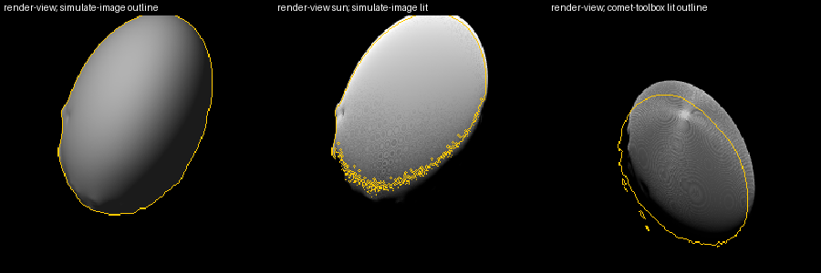

# pro3d-tool render-view

Renders OPCs **without a scene file**, from cameras you give explicitly. Each OPC is placed
by its own transformation, and a sun can optionally light the scene. The images look as
the PRo3D viewer would draw them, because they go through the same scene graph and the
same sun shading and shadows. Everything comes from a JSON job file; the tool itself uses
no SPICE.

The motivating case is Dimorphos (and Didymos) seen from HERA's AFC-1. The job file for
it is written by [`scripts/render-view-job.py`](#the-spice-job-generator) from SPICE.

```
pro3d-tool render-view --job job.json
pro3d-tool render-view --job job.json --views "afc1_20270321*" --width 512 --height 512 --no-sun
```

| Option | Default | Meaning |
|---|---|---|
| `--job <file>` | — | The job file. Required. |
| `--views <p> …` | every view | Render only these views: names with `*` / `?` wildcards, separated by spaces. **Quote** them in a shell. |
| `--out <dir>` | the job's `out`, else `<job name>-renders` beside the job | Output directory. |
| `--width`, `--height` | the job's, else 1920 × 1080 | Image size. |
| `--lod-level <n>` | the viewer's | Fix the OPC level of detail. See [render-bookmarks](./Pro3DTool-RenderBookmarks.md#fixed-level-of-detail). |
| `--no-sun` | — | Ignore every view's sun. |

**Precedence:** a value set on a view wins. Otherwise a command-line option wins. Otherwise
the job's top level applies, and then the defaults. render-bookmarks works the same way
with its passes.

The output is `<view name>.png` per view, plus `renders.json`. The manifest records the
frame label, the OPCs with their trafos, and per view the camera as rendered (with `up`
made orthogonal), the field of view, the size, the LoD and the sun direction used.

The exit code is 0 on success and 1 on any error. Every view is checked before the first
image is rendered.

## Job file

```jsonc
// illustration: the test fixture's view (2027-03-21T17:00) and Didymos as placed at
// 2027-02-25T10:30 -- a real job with both bodies has a single epoch
{
  "coordinatesAreIn": "DIMORPHOS_FIXED, metres",   // a label, see below
  "out": "renders",                                // relative to the job file
  "opcs": [
    { "path": "Dimorphos" },                       // relative to the job file
    { "path": "Didymos",
      "trafo": [ 0.9993, -0.0300,  0.0200, 1151.03,     // 2027-02-25T10:30: Didymos on
                 0.0309,  0.9985, -0.0451,    0.0,      // DIMORPHOS_FIXED's +X axis,
                -0.0186,  0.0457,  0.9988,    0.0,      // 1.15 km away
                 0,       0,       0,         1 ],
      "textured": false }
  ],
  "width": 1020, "height": 1020, "lodLevel": null, // defaults for every view
  "views": [
    { "name": "afc1_20270321T170000",
      "location": [ 8803.9, 2371.9, -67.4 ],
      "forward":  [ -0.9539, -0.3001, 0.0087 ],
      "up":       [ -0.2743, 0.8828, 0.3813 ],
      "fov": 5.5,
      "sun": { "position": [ 1.267e11, 1.338e11, 3.554e10 ], "shadows": true } }
  ]
}
```

### All numbers are in one frame, which `coordinatesAreIn` names

Every position, direction and matrix in the file is in one common frame. The OPC trafos
map *into* it; the cameras and the sun are given *in* it. **`coordinatesAreIn` only labels
that frame** for whoever reads the file or its outputs. The tool never interprets it: it
does no SPICE lookup and no conversion. It only copies the label into `renders.json`.
Changing it changes nothing in the image. Units are whatever the OPCs use, normally
metres.

### opcs

| Key | | |
|---|---|---|
| `path` | required | An OPC directory, i.e. the folder holding the hierarchies, as the viewer imports it. |
| `trafo` | identity | 16 numbers, **row-major**: `world = M · p_opc`, so the last column is the translation. Must be invertible. |
| `textured` | `true` | `false` draws the surface in plain grey, without its texture (the viewer's *Texture* switch). Use it for geometry-only renders and silhouette comparisons. |

An OPC with a legacy `<opc>.trafo` file beside it may not also get a `trafo` here. The
import would apply the file over it, so which one wins would be an accident.

### views

| Key | | |
|---|---|---|
| `name` | required | Unique. Used as the file name, so no path characters. |
| `location`, `forward`, `up` | required | The camera, `[x, y, z]`. `forward` is the viewing direction. **Image up is `up` and image right is `forward × up`.** `up` is made orthogonal to `forward`; a turn of more than 0.01° is logged. Parallel or zero vectors are errors. |
| `fov` | required | **Horizontal** field of view in degrees. The vertical one follows from the image's aspect ratio. The projection is centred, with the principal point in the image centre. |
| `width`, `height`, `lodLevel` | top level | Overrides for this view. |
| `sun` | none | `{ "position": [x,y,z], "shadows": true }`. The sun's *position* in the frame. The viewer's sun is a direction: the one from the centre of the placed OPCs' bounding box towards the position. `shadows` (default `true`) adds cast shadows (`SunShadow`); `false` gives shading only (`SunDirect`). Without `sun`, the textures are rendered unlit and untextured surfaces get the viewer's headlight. |

Unknown keys are errors, so a misspelt key cannot silently fall back to its default.
Comments and trailing commas are allowed.

Near and far planes are chosen from the camera's distance to the OPCs' bounding box, so
the depth buffer is spent on the scene even at kilometres of distance.

## The SPICE job generator

`scripts/render-view-job.py` (needs spiceypy) writes a job for HERA AFC-1 views of
Dimorphos, in `DIMORPHOS_FIXED`, metres:

```
python scripts/render-view-job.py --opc <Dimorphos OPC> --times 2027-03-21T17:00:00,2027-03-21T23:00:00 --out job.json
python scripts/render-view-job.py --opc <Dimorphos OPC> --didymos-opc <Didymos OPC> --times 2027-02-25T10:30:00 --out job.json
```

| Option | |
|---|---|
| `--kernel-root` / `--kernel` | Kernel tree (default `$PRO3D_SPICE_KERNELS`) / an explicit metakernel (default `mk/hera_plan.tm`). |
| `--didymos-opc` | Also place Didymos, by `pxform(DIDYMOS_FIXED → DIMORPHOS_FIXED)` and its position. Didymos moves around Dimorphos, so a job with both bodies covers **one epoch**. |
| `--width`, `--height` | 1020 × 1020, AFC's size. |
| `--untextured`, `--no-shadows`, `--no-sun` | As in the job file. |

Conventions, the same as `pro3d-tool simulate-image --pointing ck` for HERA_AFC-1:
- **Camera:** location is HERA relative to Dimorphos (no aberration correction).
- **Orientation:** with `R = pxform(HERA_AFC-1 → DIMORPHOS_FIXED)`, forward = `R[:,2]` (the
  boresight) and up = `R[:,0]`. Right is `R[:,1]`. This is what `specialTrafos` and
  simulate-image's camera basis compose to for AFC-1.
- **fov:** from `getfov` (AFC-1: 5.5°).
- **Sun:** SUN relative to Dimorphos.

**Pointing depends on the kernel delivery.** AFC-1 follows the CK, and the plans differ. In
the pinned test set (`v182_20260527`), AFC-1 looks at Didymos on 2027-02-25 and at Dimorphos
on 2027-03-21T17:00, but not at 14:00 or 20:00. In comet-toolbox's `v182_20260805`, it looks at
Dimorphos on 2027-02-25. A view that comes out empty most likely points elsewhere.

## Validation



*Left:* render-view, untextured and unlit, with simulate-image's silhouette in yellow.
*Middle:* render-view sun-lit, with simulate-image's lit region in yellow. *Right:*
render-view against comet-toolbox's lit outline, before alignment.

**Against simulate-image**, Dimorphos at 2027-03-21T17:00 (pinned kernels, untextured):

| | |
|---|---|
| silhouette IoU | **0.989** |
| centroid offset | **0.0 px** (1020 px frame) |
| lit-region IoU (25% of max) | 0.94 |

These numbers are with simulate-image's field of view. With the job's own 5.5°, the body
comes out **1.12% larger in area**. simulate-image hardcodes AFC-1's FOV as 5.5306897°
(`InstrumentProjection.fovs`), 0.56% wider than the instrument kernel's 5.5°; this is the
known #801 discrepancy. The level of detail makes no difference at this range.

Shading differs by design: the viewer uses Lommel-Seeliger with no ambient term, plus its
shadow acne; simulate-image uses Lommel-Seeliger with Lambert and ambient. So lit regions
are compared, not grey levels. The automated test,
`src/Tests/RenderViewTests.fs`, covers all of the above with a checked-in job and reference
(`src/Tests/data/render-view`). It needs no SPICE.

**Against comet-toolbox**, 2027-02-25T10:30, with comet-toolbox's own kernels
(`hera_plan_v182_20260805_001.tm`) and its screenshot as the reference:

| centroid-aligned lit-region IoU (15% of max) | |
|---|---|
| render-view vs comet-toolbox | **0.933** |
| simulate-image vs comet-toolbox | 0.958 |
| render-view vs simulate-image (not aligned) | 0.960, centroids 0.2 px apart |

Orientation and shape agree: same elongation, same tilt, the crater on the same limb.
comet-toolbox places the body about 0.18° from where the CK points AFC-1. It centres the
target, as Cosmographia was found to do (0.146°; docs/ShapeModelCrosscheck.md on
features/801). render-view and simulate-image both follow the CK.

## In process

```fsharp
open PRo3D.SceneRender

use renderer = new OpcRenderer(runtime, [ { path = opc; trafo = None; textured = true } ])
let camera = { location = loc; forward = fwd; up = up; fov = 5.5 }
let image  = renderer.Render(camera, Some { position = sun; shadows = true }, { size = V2i(1020, 1020); lodLevel = None })

// or a whole job, as the verb does
ViewJob.load "job.json"
|> Result.bind (fun (f, path) -> ViewJob.resolve ViewJob.noOverrides path f)
|> Result.bind (fun job ->
    use r = new OpcRenderer(runtime, job.opcs)
    ViewJob.run (printfn "%s") r job)
```

`OpcRenderer` and `SceneRenderer` (render-bookmarks) share one headless viewer core,
`ViewerRenderer`.

### How the sun gets in without SPICE

The viewer computes its sun from SPICE, for surfaces that have a SPICE body.
`Gis.SunOverride.direction` (in `src/PRo3D.GIS/GisApp.fs`) is a process-wide, never
persisted override, like `LodOverride`. While it is set:
- `GisApp.getSunDirection` returns it for every surface;
- surfaces without a body are observed as `SunOverride.BodyName`, so they receive the sun
  uniforms (`Viewer-Utils.observedBody`);
- the shadow pass uses it directly.

The lighting mode still decides whether the sun is used. The renderers set the override
per image and reset it on Dispose.

The shadow pass (`SunShadowMap`) is cached per viewer model, not per runtime, and
`SunShadowMap.release` frees it. Before this change, a second headless renderer in the
same process got the first one's shadows.
