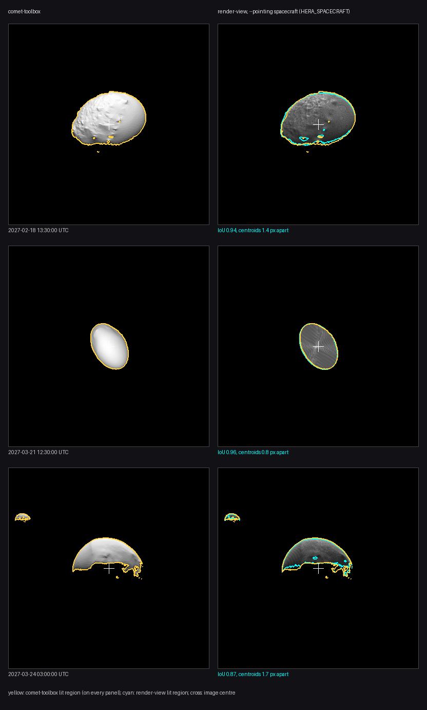
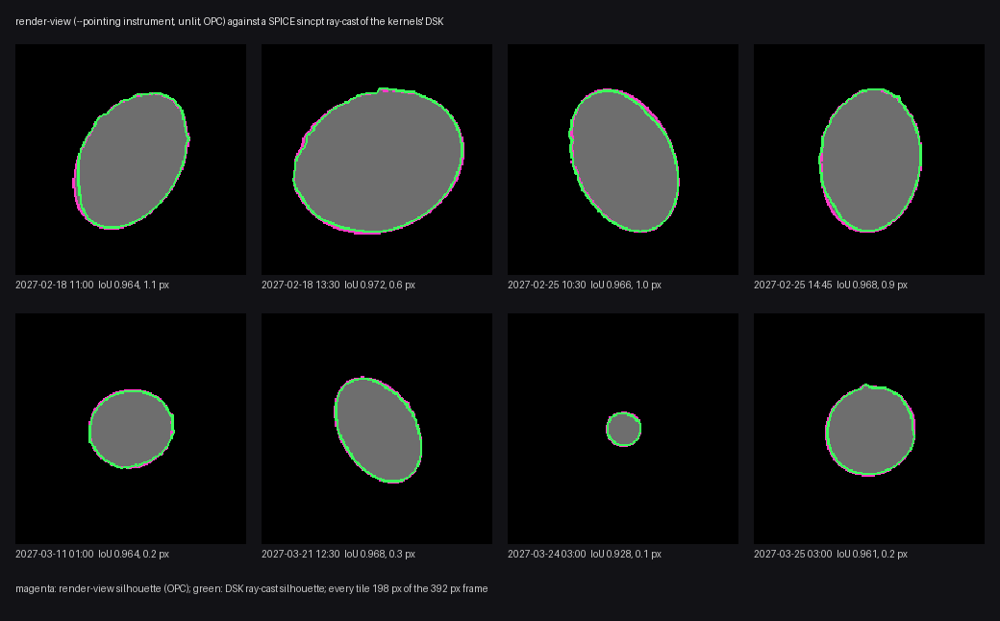

# pro3d-tool render-view

Renders OPCs **without a scene file**, from cameras you give explicitly. Each OPC is placed
by its own transformation, and a sun can optionally light the scene. The images look as
the PRo3D viewer would draw them, because they go through the same scene graph and the
same sun shading and shadows. Everything comes from a JSON job file; the tool itself uses
no SPICE.

```
pro3d-tool render-view --job job.json
pro3d-tool render-view --job job.json --views "rover_*" --width 512 --height 512 --no-sun
```

| Option | Default | Meaning |
|---|---|---|
| `--job <file>` | — | The job file. Required. |
| `--views <p> …` | every view | Render only these views: names with `*` / `?` wildcards, separated by spaces. **Quote** them in a shell. |
| `--out <dir>` | the job's `out`, else `<job name>-renders` beside the job | Output directory. |
| `--width`, `--height` | the job's, else 1920 × 1080 | Image size. |
| `--lod-level <n>` | the viewer's | Fix the OPC level of detail. See [render-bookmarks](./Pro3DTool-RenderBookmarks.md#fixed-level-of-detail). |
| `--no-sun` | — | Ignore every view's sun. |

**Precedence:** a value set on a view wins. Otherwise a command-line option wins. Otherwise
the job's top level applies, and then the defaults. render-bookmarks works the same way
with its passes.

The output is `<view name>.png` per view, plus `renders.json`. The manifest records the
frame label, the OPCs with their trafos, and per view the camera as rendered (with `up`
made orthogonal), the field of view, the size, the LoD and the sun direction used.

The exit code is 0 on success and 1 on any error. Every view is checked before the first
image is rendered.

## Job file

The cameras, the OPC placements and the sun come from outside, from whatever computes them:
a rover or orbiter camera model on Mars, SPICE for a spacecraft. The example below is one
such case: Dimorphos and Didymos as seen from HERA's AFC-1 camera, in Dimorphos' body-fixed
frame, with the Didymos OPC placed relative to Dimorphos.

```jsonc
// illustration: the test fixture's view (2027-03-21T17:00, pinned kernels) and Didymos as
// placed at 2027-02-25T10:30 with Planning v182_20261020_001 -- a real job with both bodies
// has a single epoch and one kernel set
{
  "coordinatesAreIn": "DIMORPHOS_FIXED, metres",   // a label, see below
  "out": "renders",                                // relative to the job file
  "opcs": [
    { "path": "Dimorphos" },                       // relative to the job file
    { "path": "Didymos",
      "trafo": [ 0.9993, -0.0300,  0.0200, 1151.03,     // 2027-02-25T10:30: Didymos on
                 0.0309,  0.9985, -0.0451,    0.0,      // DIMORPHOS_FIXED's +X axis,
                -0.0186,  0.0457,  0.9988,    0.0,      // 1.15 km away (DIMORPHOS_FIXED's +X
                 0,       0,       0,         1 ],  // points at Didymos by definition)
      "textured": false }
  ],
  "width": 1020, "height": 1020, "lodLevel": null, // defaults for every view
  "views": [
    { "name": "afc1_20270321T170000",
      "location": [ 8803.9, 2371.9, -67.4 ],
      "forward":  [ -0.9539, -0.3001, 0.0087 ],
      "up":       [ -0.2743, 0.8828, 0.3813 ],
      "fov": 5.5,
      "sun": { "position": [ 1.267e11, 1.338e11, 3.554e10 ], "shadows": true } }
  ]
}
```

### All numbers are in one frame, which `coordinatesAreIn` names

Every position, direction and matrix in the file is in one common frame. The OPC trafos
map *into* it; the cameras and the sun are given *in* it. **`coordinatesAreIn` only labels
that frame** for whoever reads the file or its outputs. The tool never interprets it: it
does no SPICE lookup and no conversion. It only copies the label into `renders.json`.
Changing it changes nothing in the image. Units are whatever the OPCs use, normally
metres.

### opcs

| Key | | |
|---|---|---|
| `path` | required | An OPC directory, i.e. the folder holding the hierarchies, as the viewer imports it. |
| `trafo` | identity | 16 numbers, **row-major**: `world = M · p_opc`, so the last column is the translation. Must be invertible. |
| `textured` | `true` | `false` draws the surface in plain grey, without its texture (the viewer's *Texture* switch). Use it for geometry-only renders and silhouette comparisons. |

An OPC with a legacy `<opc>.trafo` file beside it may not also get a `trafo` here. The
import would apply the file over it, so which one wins would be an accident.

### views

| Key | | |
|---|---|---|
| `name` | required | Unique. Used as the file name, so no path characters. |
| `location`, `forward`, `up` | required | The camera, `[x, y, z]`. `forward` is the viewing direction. **Image up is `up` and image right is `forward × up`.** `up` is made orthogonal to `forward`; a turn of more than 0.01° is logged. Parallel or zero vectors are errors. |
| `fov` | required | **Horizontal** field of view in degrees. The vertical one follows from the image's aspect ratio. The projection is centred, with the principal point in the image centre. |
| `width`, `height`, `lodLevel` | top level | Overrides for this view. |
| `sun` | none | `{ "position": [x,y,z], "shadows": true }`. The sun's *position* in the frame. The viewer's sun is a direction: the one from the centre of the placed OPCs' bounding box towards the position. `shadows` (default `true`) adds cast shadows (`SunShadow`); `false` gives shading only (`SunDirect`). Without `sun`, the textures are rendered unlit and untextured surfaces get the viewer's headlight. |

Unknown keys are errors, so a misspelt key cannot silently fall back to its default.
Comments and trailing commas are allowed.

Near and far planes are chosen from the camera's distance to the OPCs' bounding box, so
the depth buffer is spent on the scene even at kilometres of distance.

## Validation

### How the evaluation jobs were made

The evaluation uses the Dimorphos case: HERA's AFC-1 camera looking at Dimorphos, with
Didymos placed as well where it is in the frame. The jobs were written by
[`scripts/render-view-job.py`](../scripts/render-view-job.py) (spiceypy). It is a test aid,
not part of the tool, and it is one way of computing the cameras. Every comparison below
goes through it, so an error in it would show in all of them.

```
python scripts/render-view-job.py --opc <Dimorphos OPC> --times 2027-03-21T17:00:00 --out job.json [--didymos-opc <Didymos OPC>] [--pointing spacecraft] [--kernel <metakernel>]
```

What it computes, in `DIMORPHOS_FIXED`, metres:
- **Camera:** HERA relative to Dimorphos (no aberration correction).
- **Orientation:** with `R = pxform(HERA_AFC-1 → DIMORPHOS_FIXED)`, forward = `R[:,2]` (the
  boresight), up = `R[:,0]`, right = `R[:,1]`. These are PRo3D's AFC image axes, as
  simulate-image uses them ([Image axes](./Pro3DTool-SimulateImage.md#image-axes-specialtrafos)).
  `--pointing spacecraft` takes `HERA_SPACECRAFT` instead, without AFC-1's 0.146° alignment.
- **fov:** from `getfov` (AFC-1: 5.5°).
- **Sun:** SUN relative to Dimorphos.
- **Didymos** (`--didymos-opc`): placed by `pxform(DIDYMOS_FIXED → DIMORPHOS_FIXED)` and its
  position, so a job with both bodies covers one epoch.

### Against comet-toolbox



For evaluation we compare with comet-toolbox's HERA dashboard
(<https://comet-toolbox.com/dashboard/hera/>), which points along the spacecraft's +Z axis, so
render-view runs with `--pointing spacecraft`.
Setup:
- Kernels: Planning `v182_20261020_001`, the version the dashboard showed.
- References: its screenshots, 392 px, the full 5.5° field. They are kept in
  PRo3D.Resources.TestData under `HERA/comet-toolbox`, with attribution.
- Renders: untextured, with Didymos placed as well.
- Lit regions (above DN 25) are compared as they are, not re-centred.

Reproduce with [`scripts/compare-render-view-toolbox.py`](../scripts/compare-render-view-toolbox.py).

| Epoch (UTC) | Phase | lit-region IoU | centroid offset |
|---|---|---|---|
| 2027-02-18 11:00 | 12° | 0.94 | 2.0 px |
| 2027-02-18 13:30 | 34° | 0.94 | 1.4 px |
| 2027-02-25 10:30 | 36° | 0.93 | 2.6 px |
| 2027-02-25 14:45 | 57° | 0.86 | 4.8 px |
| 2027-03-11 01:00 | 71° | 0.78 | 1.6 px |
| 2027-03-21 12:30 | 0° | 0.96 | 0.8 px |
| 2027-03-24 03:00 (AFC-1 on Didymos) | 91° | 0.87 | 1.7 px |
| 2027-03-25 03:00 | 79° | 0.65 | 6.0 px |

Position, orientation, size and shape agree. The lit regions differ near the terminator,
where the viewer's shading darkens earlier than comet-toolbox's. That difference grows with
the phase angle, so the 71° and 79° epochs score lowest.

### Against simulate-image

Dimorphos at 2027-03-21T17:00, pinned kernels, untextured, 1020 px, both at AFC-1's 5.5°:

| | |
|---|---|
| silhouette IoU | **0.988** |
| centroid offset | **0.1 px** |
| equivalent radius | **+0.5 px** (render-view's 8× MSAA counts partly covered edge pixels) |
| lit-region IoU (25% of max) | 0.96 |

The level of detail makes no difference at this range. Shading differs by design: the viewer
uses Lommel-Seeliger with no ambient term, simulate-image Lommel-Seeliger with Lambert and
ambient. So lit regions are compared, not grey levels. `src/Tests/RenderViewTests.fs` checks
all of this with a checked-in job and reference (`src/Tests/data/render-view`); it needs no
SPICE.

### Against the kernels' own shape model



An independent geometry check with no PRo3D code on the reference side: a ray-cast through
SPICE (spiceypy `sincpt` with `DSK/UNPRIORITIZED`, one ray per pixel) of the shape model the
kernels ship, `dsk/g_00243mm_spc_obj_dimo_0000n00000_v004.bds` (SPC, 0.24 m), loaded by the
Planning v182 metakernel. The ray-cast is `dsk_silhouette` in
[`scripts/compare-render-view-toolbox.py`](../scripts/compare-render-view-toolbox.py)
(`--raycast`). It is compared with render-view's unlit Dimorphos silhouette at the same epochs,
392 px, with `--pointing instrument`: both cameras then come from the `HERA_AFC-1` frame.

| Epoch (UTC) | silhouette IoU | centroid offset |
|---|---|---|
| 2027-02-18 11:00 | 0.964 | 1.1 px |
| 2027-02-18 13:30 | 0.972 | 0.6 px |
| 2027-02-25 10:30 | 0.966 | 1.0 px |
| 2027-02-25 14:45 | 0.968 | 0.9 px |
| 2027-03-11 01:00 | 0.964 | 0.2 px |
| 2027-03-21 12:30 | 0.968 | 0.3 px |
| 2027-03-24 03:00 | 0.928 | 0.1 px |
| 2027-03-25 03:00 | 0.961 | 0.2 px |

The outlines differ by about a pixel along the limb: render-view draws the OPC
(`Dimorphos_DRACO1_DRACO2_Earth`, 1.96 m), the ray-cast the finer DSK. On 03-24 Dimorphos is
about 15 px across, so that pixel weighs more.

## In process

```fsharp
open PRo3D.SceneRender

use renderer = new OpcRenderer(runtime, [ { path = opc; trafo = None; textured = true } ])
let camera = { location = loc; forward = fwd; up = up; fov = 5.5 }
let image  = renderer.Render(camera, Some { position = sun; shadows = true }, { size = V2i(1020, 1020); lodLevel = None })

// or a whole job, as the verb does
ViewJob.load "job.json"
|> Result.bind (fun (f, path) -> ViewJob.resolve ViewJob.noOverrides path f)
|> Result.bind (fun job ->
    use r = new OpcRenderer(runtime, job.opcs)
    ViewJob.run (printfn "%s") r job)
```

`OpcRenderer` and `SceneRenderer` (render-bookmarks) share one headless viewer core,
`ViewerRenderer`.

### How the sun gets in without SPICE

The viewer computes its sun from SPICE, for surfaces that have a SPICE body.
`Gis.SunOverride.direction` (in `src/PRo3D.GIS/GisApp.fs`) is a process-wide, never
persisted override, like `LodOverride`. While it is set:
- `GisApp.getSunDirection` returns it for every surface;
- surfaces without a body are observed as `SunOverride.BodyName`, so they receive the sun
  uniforms (`Viewer-Utils.observedBody`);
- the shadow pass uses it directly.

The lighting mode still decides whether the sun is used. The renderers set the override
per image and reset it on Dispose.

The shadow pass (`SunShadowMap`) is cached per viewer model, not per runtime, and
`SunShadowMap.release` frees it. Before this change, a second headless renderer in the
same process got the first one's shadows.
