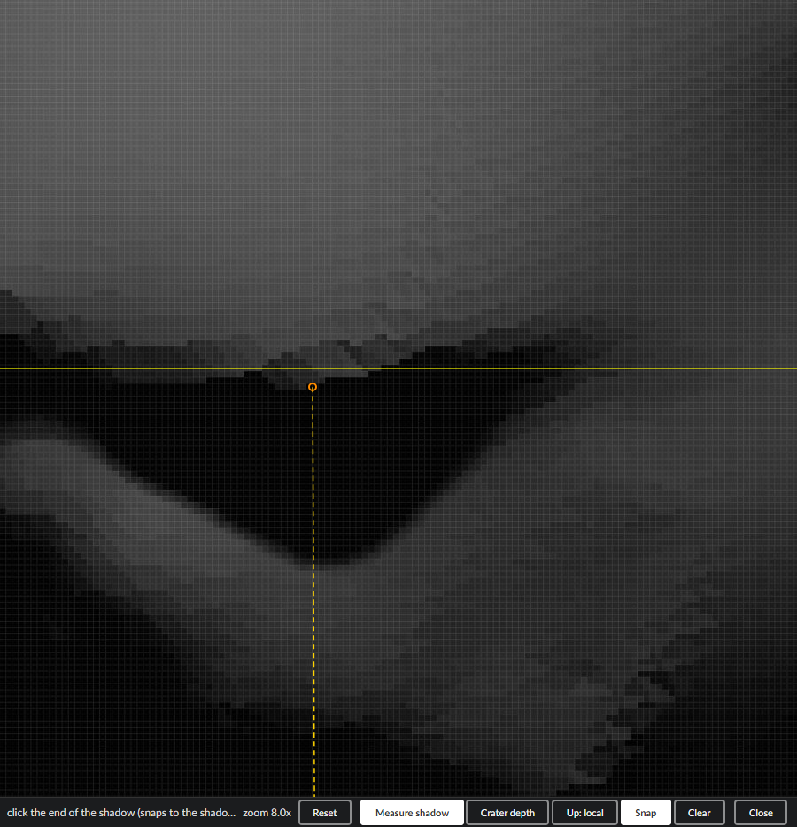
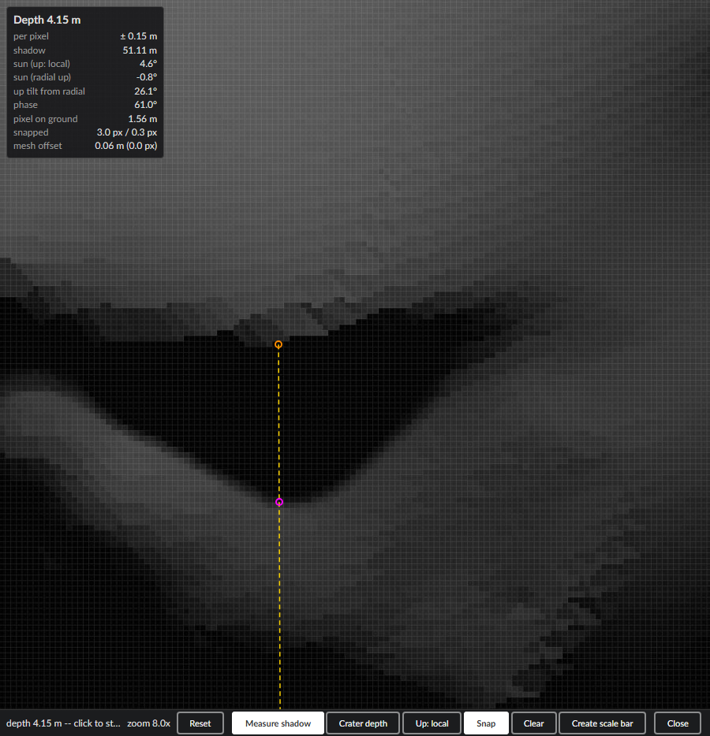

# Shadow Measurement (experimental)

Measures the **depth of a crater** or the **height of a boulder** from the length of its shadow in
a projected instrument image:

> height = shadow length × tan(sun elevation)

The sun direction comes from SPICE at the image's acquisition time, the geometry from the image's
camera and the surface mesh. The tool lives in the [Image Inspector](ImageInspector.md) panel.
The design and its verification are in [dev/shadowEstimation.md](dev/shadowEstimation.md).

**What it adds to the shape model.** A shape model is smoothed and limited to its own vertex
spacing; an image resolves more, and a shadow records relief at the image's resolution. The tool
turns that into numbers the mesh cannot give: the height of a boulder smaller than the mesh's
triangles, the depth of a crater the model smoothed out, and — where the model does resolve the
feature — an independent check of it (the *mesh offset*). Only one end of a measurement comes from
the mesh, on terrain a coarse model gets right (a crater rim, the ground beside a boulder); the
other end is triangulated from the image and the sun alone.

## What you need

- A surface (OPC) **bound to a SPICE body**, and an **observed body** set (*GIS View*).
- **SPICE kernels** covering the image's time.
- A **projected image** with its `.mbi.json` sidecar (the acquisition time comes from there),
  **selected** under *GIS View → projected images*.
- The **Image Inspector** panel (GIS window layout, or add it to any layout), opened past its
  *experimental feature* notice with **Open anyway**.

Good images have the sun **low** (long shadows) but not grazing, and a **phase angle well above
15°** (camera and sun rays far from parallel).

## Measuring a crater's depth

1. Zoom in on the crater (mouse wheel; drag pans). Light borders appear around image pixels when
   zoomed in far enough — that is the precision of a click.
2. Click **Measure shadow** in the bottom bar. The button next to it reads **Crater depth**.
3. **First click: the rim, where the shadow begins.** With **Snap** on (the default) the click
   moves along the sun direction onto the rim's dark end ([Snapping](#snapping)). An orange
   dot marks it, and a dashed yellow **sun line** appears: where the shadow can lie.

   

   *Zoomed 8× on a Didymos crater, sun from the top. The yellow crosshair is where the click
   was; Snap moved it 3 px down the sun line to the rim's dark end (orange ring).*
4. **Second click: the end of the shadow**, on the crater floor. The click moves onto the sun
   line, then snaps onto the shadow's edge (magenta dot).
5. Read the result in the **result box** at the panel's top-left. The next click starts a new
   measurement; **Clear** discards the current one.

   

   *Depth 4.15 m from a 51 m shadow with the sun 4.6° above the local horizon. Measured against
   the radial horizon the sun would be below it (−0.8°): the terrain here tilts 26° — see
   [Which "up"](#which-up). Mesh offset 0.0 px: the clicks sit on the shadow's edges.*

## Measuring a boulder's height

1. Click **Crater depth** to switch it to **Boulder height**.
2. **First click: the tip of the boulder's shadow, on the ground.** It snaps onto the shadow's
   end. The sun line now points from there towards the sun.
3. **Second click: the boulder's top edge** that casts the shadow tip. It moves onto the sun line
   but is not snapped — there is no reliable image edge at a boulder's top.

The boulder itself need not exist in the mesh: its top is triangulated from the image.

## Reading the result

| Row | Meaning |
|---|---|
| **Depth** / **Height** | below the rim / above the ground, in metres |
| per pixel | how much the result changes when the second click moves one pixel along the sun line — your resolution |
| shadow | horizontal length of the shadow |
| sun (up: …) | sun elevation above the horizon of the chosen [up](#which-up) |
| sun (radial up), up tilt from radial | the same for the radial horizon, and how far the chosen up tilts from it |
| phase | angle between sun and camera; below 15° the box warns that the result is unreliable |
| pixel on ground | the image's ground resolution at the second point |
| snapped | how far snapping moved the two clicks, in pixels |
| mesh offset | distance between the triangulated point and the mesh under the second pixel |

**The mesh offset is the quality check.** Where the mesh resolves the crater, a correct
measurement lands on it: the offset stays well below a pixel (on a test frame: median 0.2 m at
1.6 m pixels). Above 0.5 px the box warns that the clicks are probably not on the shadow's edges.
For a boulder the mesh may not contain it — a large offset there is expected.

## How the sun elevation is computed

1. **Sun direction** — SPICE: the sun's position relative to the observed body at the image's
   acquisition time (from the `.mbi.json`, never the scene's time), in the body-fixed frame,
   carried into the scene with the surface's placement. One direction serves the whole image.
2. **Up** — a unit vector at the first click: by default the normal of the surrounding terrain
   (see [Which "up"](#which-up)).
3. **Elevation** = asin(sun · up): the sun's angle above the plane perpendicular to up. At or
   below 0° there is no result (*the sun is … below this horizon*).

The measurement itself does not use the formula above directly. The second end is where the
camera ray through its pixel meets the sun ray through the first end; depth or height is that
point's offset from the first end along up — which equals shadow length × tan(elevation). The
triangulated point does not depend on up; up only decides what counts as "vertical".

### How robust it is

- **Sun direction:** not a concern — SPICE is far more accurate than a click; the sun's disc only
  softens the shadow's edge.
- **Up:** the dominant error. One degree off changes the result by cot(elevation) × 1.75 %:
  ~3 % with the sun 30° up, ~22 % at 4.6°. Radial up can fail outright: in the screenshot the
  terrain tilts 26° and the sun is below the radial horizon.
- **Clicks:** *per pixel* gives the change for one pixel along the shadow.

## Which "up"

- **Up: local** (default) — the mesh under a ring 24 px around the first click: the surrounding
  terrain, not the crater wall.
- **Up: radial** — from the body centre.
- **Up: plane** — after the second click, click two or more points on the rim (or the ground
  around a boulder); the result updates with each.

## Snapping

**Snap** (default on) moves a click along the sun line onto the nearest shadow edge within 6 px:
for a rim, to where its brightness ramp turns dark (the point that casts the shadow); for a
shadow's end, halfway across the edge. On a Didymos test frame it cut the spread from clicks 3 px
off the edges from 3 m to under 0.5 m.

## 3D view and scale bars

Depth-tested markers: axis crosses at both ends (red towards the sun, green across, blue up),
the sun ray (yellow), the depth or height (cyan) and the mesh under the second click (gray). They
show while **Measure shadow** is on and the measured image is selected.

**Create scale bar** adds two ordinary scale bars, one at each end, as tall as the result and
along the camera's sky — the only thing the tool saves with the scene.

## Pitfalls and limits

- Zoom in, keep Snap on, and watch the *mesh offset*.
- Depth is to the shadow's tip: a shadow ending before the crater's centre underestimates a bowl.
- Below 15° phase the result is unreliable.
- A measurement belongs to its image and scene time; change either and measure again.
- Pixels are assumed square (true for Hera AFC).
- Simulated test frames (`pro3d-tool simulate-image`, as in the screenshots) need
  `--shadow-bias 0.006`; the default 0.002 adds false shadow speckles on grazing slopes.

Screenshots: `tests-ui/tests/shadow-measurement-docshots.spec.ts` (`PRO3D_DOC_SHOTS=1`).
