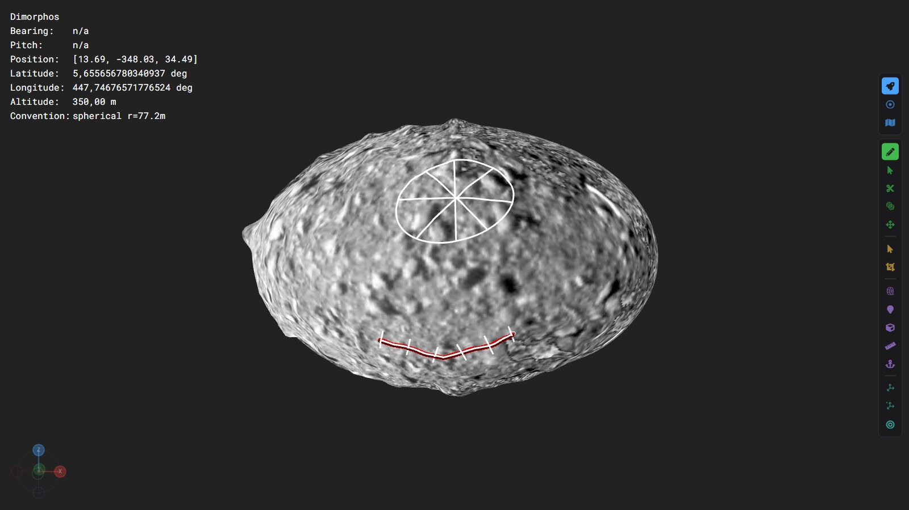
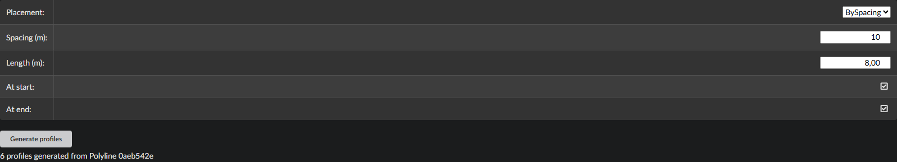
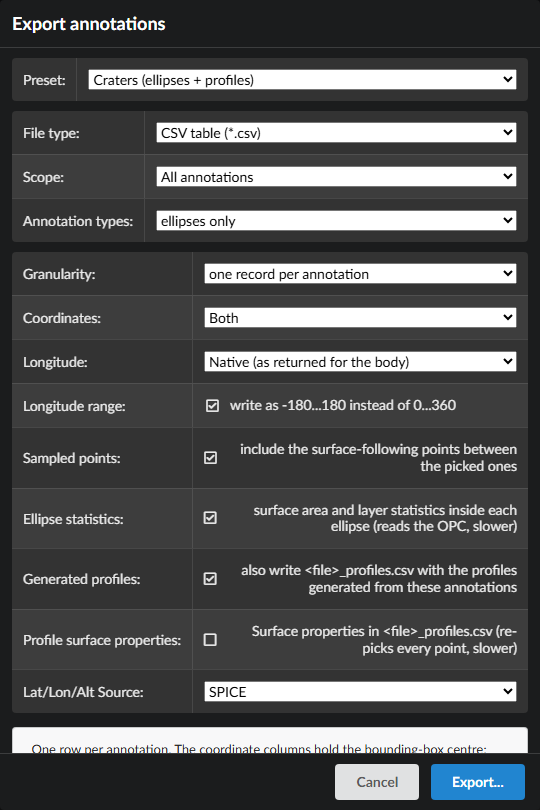

# Supporting profiles

PRo3D can lay **profiles** across your annotations for you: short *Sky*-projected lines you would otherwise draw by hand, one at a time.

- **Lineaments.** Across a polyline: perpendicular profiles every so many metres, or a fixed number of them spread evenly along it.
- **Craters.** Through an ellipse: four profiles through its centre, rim to rim, along the compass directions or the ellipse's own axes.

Each profile remembers which polyline or ellipse it belongs to. The *Lineaments* and *Craters* exports write the polylines or ellipses together with their profiles, so you can plot every profile of every lineament or crater in your own tools.



Issue [#833](https://github.com/pro3d-space/PRo3D/issues/833).

## Generating profiles

### For an existing polyline or ellipse

1. Select the polyline, line or ellipse: click it in the annotation list, or use *Select annotation* in the 3D view.
2. Open **Properties → Supporting Profiles**.
3. Check the settings (see [Settings](#settings)) and press **Generate profiles**.



The line under the button says what happened: how many profiles were generated and from which annotation, or why none were.

### Automatically, while drawing

The drawing toolbar can generate the profiles for you as soon as you finish an annotation:

| Drawing | Tick in the toolbar | The toolbar then also shows |
|---|---|---|
| Polyline | **Lineament profiles** | placement, spacing or count, length, start, end |
| AxisEllipse | **Crater profiles** | the directions |


While the box is ticked, every polyline gets its profiles when you press **Enter**, and every ellipse when you click its last point. A short notice reports the outcome. Both boxes start unticked.

- **The settings are shared.** The toolbar shows the same values as Properties → Supporting Profiles: change one and the other follows. Whatever you used for your last manual generation is what the toolbar uses, and the reverse. They reset to their defaults when PRo3D restarts.
- **Undo** first removes the profiles, then, on the second Ctrl+Z, the annotation itself.
- **Line** has no checkbox: a line is what a profile itself is.

### Where the profiles go

- **Group:** the active group.
- **Name:** `p<label of the polyline or ellipse>_<number>`, e.g. `pCraterA_0`, `pCraterA_1`, …. When the parent has no label, the first 8 characters of its id stand in for it.
- **Appearance:** the group's default colour and the drawing tool's current thickness. Their labels are switched off; *Show text* in a profile's properties brings one back.
- **Sampling:** each profile is draped onto the surface like a hand-drawn *Sky* line, using the toolbar's **Sampling** distance at the moment you generate. Change that first for denser or coarser profiles.
- **Selection:** the polyline or ellipse stays selected, so you can generate again with other settings.
- **Undo:** one **Ctrl+Z** removes all profiles of one generation.

**All or nothing:** if one profile cannot be built, typically because one of its ends would hang off the edge of the mesh, **no** profiles are created, and the message says which one failed. Shorten the length or move away from the edge, then generate again.

## Settings

### Polylines (lineaments)

| Setting | Meaning |
|---|---|
| Placement | **BySpacing**: one profile every *Spacing* metres. **ByCount**: *Count* profiles, equally spaced over the whole polyline. |
| Spacing (m) | BySpacing only: distance from one profile to the next along the polyline. |
| Count | ByCount only: the number of profiles on the polyline. |
| Length (m) | Total length of every profile, centred on the polyline. |
| At start / At end | Whether there is a profile at the polyline's first / last point. |

Where the profiles land on a polyline *S* metres long:

| At start | At end | BySpacing, spacing *d* | ByCount, *N* profiles |
|---|---|---|---|
| ✓ | ✓ | 0, *d*, 2*d*, …, *S* | 0, *S*/(*N*−1), …, *S* (needs *N* ≥ 2) |
| ✓ | – | 0, *d*, 2*d*, … (the last one before *S*) | 0, *S*/*N*, …, (*N*−1)·*S*/*N* |
| – | ✓ | *d*, 2*d*, …, *S* | *S*/*N*, …, *S* |
| – | – | *d*, 2*d*, … (the last one before *S*) | *S*/(*N*+1), …, *N*·*S*/(*N*+1) |

- **ByCount gaps are always equal.** An end without a profile still counts as a position, so the profiles stay evenly spaced.
- **BySpacing's last gap is the rest.** The gap before the end is whatever remains, e.g. a 48.9 m polyline with *d* = 10 gets profiles at 0, 10, 20, 30, 40 and 48.9.
- **Refusals.** Settings that leave no profile at all are refused with a message: a polyline shorter than the spacing with both ends off, or *Count* 1 with both ends on.

How a polyline profile sits on the line:

- **Right angle.** Each profile crosses the polyline at a right angle to the segment it lies on, in the local horizontal plane.
- **Bends are not special.** The positions carry on through bends. A profile that falls exactly on a vertex follows the segment after it. On a sharp bend, neighbouring profiles can cross on the inside.
- **Which end comes first.** Every profile starts on the **left** of the polyline, looking along it from its first point.
- **How positions are measured.** Along the straight lines between the points you clicked, not along the draped surface. On rough terrain the draped polyline is a little longer than that.

### Ellipses (craters)

| Directions | Profiles, in this order | Starts at |
|---|---|---|
| Compass | `N-S`, `NE-SW`, `E-W`, `NW-SE`: local north at the ellipse's centre. Needs a reference body. | the first-named end: `N-S` at the north rim |
| MajorAxis | `major`, `major+45`, `minor`, `major+135`: in the ellipse's own plane, clockwise seen from above | the end of the major axis that lies more to the north |

- **Rim to rim.** Every profile runs through the ellipse's centre and ends **exactly on the drawn outline** on both sides. On a four-point ellipse with two different widths, the two halves of a profile therefore differ in length.
- **Older ellipses.** Ellipses drawn before PRo3D stored their shape (6.3.3 and earlier) cannot be used; redraw them.

## Exporting: craters and lineaments with their profiles

**Annotations → Export…** has two presets for this. Each writes **two CSV files** in one go:

| Preset | Main file `<name>.csv` | Profiles file `<name>_profiles.csv` |
|---|---|---|
| **Craters (ellipses + profiles)** | one row per ellipse, exactly as the *Boulders* preset: semi-axes, long-axis azimuth, centre, surface statistics | every profile generated from those ellipses, one row per point |
| **Lineaments (polylines + profiles)** | one row per line or polyline: `length`, `wayLength`, `bearing`, centre. The generated profiles are lines too, but they are left out of this file. | every profile generated from those polylines, one row per point |



Steps:

1. **Annotations → Export…**
2. Choose the preset **Craters (ellipses + profiles)** or **Lineaments (polylines + profiles)**.
3. Optional: tick **Surface properties in `<file>_profiles.csv`** to add the OPC's layers (slope, elevation, …) to every profile point. This is slower, because every point is looked up on the surface again.
4. Press **Export…** and choose the file name for the main file. The profiles file is written next to it, with `_profiles` added to the name.

Both presets export **all** ellipses or lines in the scene, visible or not. A profile goes into the profiles file when its parent is in the main file, wherever the profile sits in the annotation tree. If none of the exported annotations has profiles, the profiles file contains only its header row, and the export window says so.

### How profiles are tied to their crater or lineament

Every row of the profiles file carries the parent's id and which profile it belongs to:

| Column | Meaning |
|---|---|
| `key` | the profile's own id; the same on every row of one profile |
| `parentKey` | **the `key` of its ellipse or polyline in the main file** |
| `profileIndex` | 0, 1, 2, … in the order the profiles were generated |
| `profileDirection` | `N-S`, `NE-SW`, `E-W`, `NW-SE` (or `major`, … ); empty for lineament profiles |
| `profileAzimuth` | bearing from the profile's centre to its start, clockwise from north, 0–360°: 0 for `N-S`, 45 for `NE-SW`, 90 for `E-W`, 315 for `NW-SE` |
| `profileStation` | lineament profiles: metres along the polyline where the profile crosses it |
| `pointIndex` | position of the row along the profile, from 0 at its start |
| `distance` | metres along the profile from its start; plot this on the horizontal axis |
| `lat`, `lon`, `alt`, `x`, `y`, `z` | the point itself |
| `surface_<layer>` | only with *Surface properties* ticked: the OPC layer's value at the point |

The rows come grouped by crater or lineament, in the order of the main file, then by profile, then along the profile.

To get **all profiles of one crater**, take the rows whose `parentKey` equals the crater's `key` in the main file. Within those, rows with the same `key` (or the same `profileDirection`) form **one profile**, ordered by `pointIndex`. For lineaments, `profileStation` tells you where along the lineament each profile lies. Sort by it to walk along the lineament.

`segmentIndex` is always 0 in this file, because each profile is a single straight segment between its two ends.

### Example

A crater exported with *Craters* and its four compass profiles (from PRo3D's own test on Dimorphos, x/y/z and a few bookkeeping columns left out):

```csv
craters.csv
key,text,surfaceName,groupPath,semiMajorAxis,semiMinorAxis,majorAxisAzimuth,...,lat,lon,alt,...
54be6d14-baf0-4150-98fb-5bc41c848370,,Dimorphos,,21.18,16.66,64.15,...,19.06,-87.40,77.21,...
```

```csv
craters_profiles.csv
key,text,parentKey,profileIndex,profileDirection,profileAzimuth,profileStation,pointIndex,lat,lon,alt,distance
83cd77eb-…,p54be6d14_0,54be6d14-baf0-4150-98fb-5bc41c848370,0,N-S,0,,0,31.54,-87.86,77.48,0
83cd77eb-…,p54be6d14_0,54be6d14-baf0-4150-98fb-5bc41c848370,0,N-S,0,,1,30.81,-87.84,77.91,1.09
…
910747fb-…,p54be6d14_1,54be6d14-baf0-4150-98fb-5bc41c848370,1,NE-SW,45,,0,29.79,-75.52,75.92,0
910747fb-…,p54be6d14_1,54be6d14-baf0-4150-98fb-5bc41c848370,1,NE-SW,45,,1,29.28,-76.17,76.24,1.05
…
```

The crater has no label, so its profiles are named after the first 8 characters of its id. Every profile row's `parentKey` is the crater's `key`; `N-S` starts at the northern rim (latitude 31.5°, the crater's centre is at 19.1°) and `distance` counts from there.

Reading it in Python with pandas:

```python
import pandas as pd
craters  = pd.read_csv("craters.csv")
profiles = pd.read_csv("craters_profiles.csv")

# every profile point with the columns of its crater
joined = profiles.merge(craters, left_on="parentKey", right_on="key", suffixes=("", "_crater"))

# one profile: crater 0, north-south, in order along the profile
crater = craters["key"][0]
ns = joined[(joined.parentKey == crater) & (joined.profileDirection == "N-S")].sort_values("pointIndex")
ns.plot(x="distance", y="alt")
```

For lineaments, swap in `lineaments.csv` / `lineaments_profiles.csv`, and group by `profileStation` instead of `profileDirection`.

Every column of both files is described in [AnnotationExport-CSV.md](AnnotationExport-CSV.md#craters) (and [Lineaments](AnnotationExport-CSV.md#lineaments)). The *Profile* preset writes the same profile columns for any line you export with it, empty for hand-drawn ones.

## Good to know

- **What a profile remembers.** Each generated profile stores its parent, index, direction, azimuth and station in the scene file. These are fixed when the profile is generated: moving a profile's points afterwards does not update them. Older PRo3D releases load scenes with generated profiles fine; they show them as plain lines.
- **Deleting the parent** leaves its profiles in place. They are no longer exported with *Craters* or *Lineaments*, because their parent is gone.
- **Settings and the two toolbar checkboxes** reset to their defaults when PRo3D restarts: spacing 10 m, count 5, length 20 m, both ends on, compass directions, auto-generation off.
